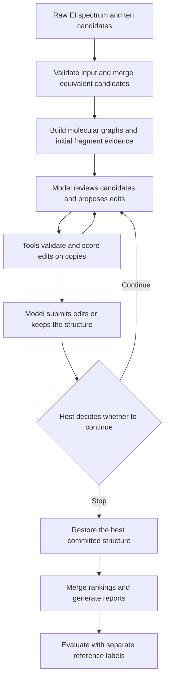

# GC–MS Research Agent

> **Monorepo directory note:** In this document, “repository root” means the `GCMS-Agent/` subdirectory. After cloning the parent repository, run `cd GCMS-Agent` before following these commands. Local environments, configuration and `.env` (if used) belong in this subdirectory. See the [project overview](../README.md).

**English** | [简体中文](README.zh-CN.md)

Review ten candidate SMILES generated by an upstream model against a raw electron-ionization (EI) mass spectrum. The agent proposes structure edits under heavy-atom composition constraints; chemical tools validate, score, and rerank the candidates. Outputs include structures, fragment evidence, edit histories, and explanatory reports.

The model accesses controlled tools through the Claude Agent SDK/Harness. The Python host handles graph edits, chemical validation, scoring, commits, and stopping decisions. Two execution modes are available:

| Mode | Behavior | Requirements |
|---|---|---|
| `baseline` | Deterministic validation, scoring, and ranking of input candidates | No API key, model calls, or structure edits |
| `agent` | Model review, edit trials, and submissions; host validation and persistence | A configured model service and API key; model calls incur charges |

[Case studies](#case-studies) · [Installation](#install-from-scratch) · [Offline examples](#run-the-public-examples) · [Run the agent](#run-the-agent) · [Technical documentation](docs/README.en.md)

The homepage, core technical documentation, configuration, data, script, and test guides, and public case-study narratives are available in English and Chinese. Original model explanations in the case studies retain their recorded language. Skill and resource directory guides are also bilingual. Runtime skill text, on-demand references, instructional examples, and generated explanatory reports retain their original language, mostly Chinese.

## Case studies

Browse the [case-study index](case_studies/README.en.md) without installing the project. Each case includes input data, separate reference labels, structure-change figures, round-by-round edits, all tool trials, compact results, and provenance checks.

| Case | What it illustrates | Limits of the recorded result |
|---|---|---|
| [Hexa-2,4-dienedinitrile](case_studies/hexa-2,4-dienedinitrile/README.en.md) | Multi-round exploration and restoration of the historical best structure | Historical scoring used binned intensities; recorded Top1 matches the reference, but the run is incomplete |
| [Butyl butanoate](case_studies/butyl-butanoate/README.en.md) | Service failure, retry, and generation of the reference structure | Reference structure is second in the displayed ranking; the retry is also incomplete |
| [Trimethylpentylsilane](case_studies/trimethylpentylsilane/README.en.md) | Silicon-containing structure edits and tied scores | Reference structure is sixth in display order and tied for first by evidence score; the run is incomplete |

The three main Agent stages preserve **62 trials**, including rejected and unselected trials; the initial service failures are documented separately. These are historical development cases explicitly authorized for public release. They retain their original scores and incomplete status and do not establish the current version's accuracy. The hexa-2,4-dienedinitrile display input uses raw intensities from `Agent-Harness/test.json`. Its trajectory and ranking come from the historical binned-intensity run.

## Installation and quick start

Verified environment: **Windows x86-64 / Python 3.10.19**. Other operating systems and Python versions have not been verified. `requires-python >=3.10` declares a minimum version; it does not guarantee that the dependency combination installs on every newer version. Dependencies are declared in [pyproject.toml](pyproject.toml). [requirements.lock](requirements.lock) pins runtime, test, and historical environment packages for Windows / Python 3.10.

Download or clone the **complete repository** and retain its directory structure. This release uses an editable installation to access `configs/`, `skills/`, and `resources/` in the checkout. A regular wheel installation does not yet include these external resources. Repeat the editable installation if you move the checkout.

### Install from scratch

Run the following in PowerShell from the repository root. Create a new `.venv`; if you already have a research environment, choose a different environment path and update the commands accordingly. Do not reuse another project's environment or enable `--system-site-packages`.

```powershell
# Install 64-bit Python 3.10, then create an isolated environment.
# Without the py launcher, replace py -3.10 with the full Python 3.10 executable path.
py -3.10 -m venv .venv
$env:PYTHONIOENCODING = 'utf-8'
$env:PYTHONDONTWRITEBYTECODE = '1'
# Clear a process-level source path that might point to an old checkout.
# This does not change system settings.
Remove-Item Env:PYTHONPATH -ErrorAction SilentlyContinue

# Initial installation requires access to a Python package index, but no model API key.
.\.venv\Scripts\python.exe -m pip install -r requirements.lock
.\.venv\Scripts\python.exe -m pip install -c requirements.lock -e ".[test]"

# Check dependencies and imports: gcms_agent should resolve to this checkout's src/gcms_agent.
.\.venv\Scripts\python.exe -m pip check
.\.venv\Scripts\python.exe -B -c "import gcms_agent; print(gcms_agent.__file__)"
.\.venv\Scripts\gcms-agent.exe --help
```

Installation verification on 2026-11-18 used a fresh Windows / Python 3.10.19 environment without inherited system packages. Dependency installation, editable installation, `pip check`, the CLI entry point, 398 offline tests, and baseline execution, plotting, and evaluation for both public examples passed. `PYTHONPATH` was unset, and no live model calls were made.

The `[test]` extra declares pytest; it is also included in the pinned environment file. Pillow is a direct dependency for structure plots and case-study images. Build tools are resolved separately by pip, and the current requirements file does not pin artifact hashes.

Baseline execution and offline tests do not invoke a model. Live Agent runs require service configuration and an API key. The pinned Windows SDK package includes a native `claude.exe`, which the SDK locates when `cli_path` is unset. See the [configuration guide](configs/README.en.md) for a custom executable path.

### Run the public examples

Complete installation first, then run these commands in PowerShell from the repository root. Two [independently constructed synthetic examples](data/examples/README.en.md) demonstrate the workflow without private data or an API key. They are not measured spectra or model-performance benchmarks. Use a new output directory for each run.

```powershell
$env:PYTHONIOENCODING = 'utf-8'
$env:PYTHONDONTWRITEBYTECODE = '1'

# Deterministically score both inputs and generate structures, evidence, and reports.
.\.venv\Scripts\python.exe -B -m gcms_agent.cli run data\examples\inference.json --mode baseline --output runs\public_example

# Evaluate separately after the run; do not omit --labels.
.\.venv\Scripts\python.exe -B -m gcms_agent.cli evaluate runs\public_example --labels data\examples\labels.json --input data\examples\inference.json

# Run the complete offline test suite.
.\.venv\Scripts\python.exe -B -m pytest -q -p no:cacheprovider
```

Start with the Markdown reports and PNG structure/spectrum plots in `runs/public_example/reports/`, then inspect the rankings in `results/` and the metrics in `evaluation.json`. The workflow should process two inputs and retain ten source slots per input. Equivalent candidates share computation, so the number of unique structures may be smaller than ten.

## Run the agent

After the offline examples, you can use the same synthetic input to check the live model workflow. Copy the contents of [.env.example](.env.example) into a local `.env` at the repository root and set `DEEPSEEK_API_KEY`. If `.env` already exists, edit it while preserving its existing contents. A process environment variable can also supply the key and takes precedence.

Review the endpoint and model settings in [model.yaml](configs/model.yaml) first. The repository currently records `deepseek-flash[1m]`, `thinking: true`, and `effort: low`; check service availability and actual pricing with your provider account. See the [configuration guide](configs/README.en.md) for model integration and SDK startup.

```powershell
# Makes live model calls. Set an explicit CNY 10 scheduling budget and use a new directory.
.\.venv\Scripts\python.exe -B -m gcms_agent.cli run data\examples\inference.json --mode agent --output runs\public_agent_example --budget-cny 10

# Evaluate separately after inference; reference labels are not given to the model.
.\.venv\Scripts\python.exe -B -m gcms_agent.cli evaluate runs\public_agent_example --labels data\examples\labels.json --input data\examples\inference.json

# Use only when continuing the same run; input, configuration, and source fingerprints must be compatible.
.\.venv\Scripts\python.exe -B -m gcms_agent.cli resume data\examples\inference.json --output runs\public_agent_example --budget-cny 10
```

Agent runs default to `economy`, with at most two concurrent batches for the same spectrum. Its `offpeak_only: true` setting stops new sessions during locally configured peak hours and records `offpeak_wait`. Resume explicitly during an allowed period; no background scheduler restarts the run. The base configuration has no default total monetary cap. The example budget is a host-side scheduling estimate, not a provider-enforced billing limit. See [budget and scheduling](configs/README.en.md#scheduling-budgets-and-special-values) and [resume requirements](docs/editing_and_stopping.en.md#resume).

## Workflow



This diagram shows the Agent path. The baseline ranks candidates directly after initial validation and scoring. The model reads molecular graphs through MoleCode and identifies edits by candidate ID, graph version, and atom ID. Tool trials do not automatically change committed results; submissions are checked again by the host.

Valid exploration may produce equal or lower scores. The host stores the current exploration graph separately from the best committed structure. Nonempty final structures must pass neutrality, connectivity, closed-shell, valence, and round-trip checks. Edits preserve the counts and identities of heavy atoms of each element. See the [architecture](docs/architecture.en.md), [molecular contract](docs/molecode_contract.en.md), and [edit acceptance and stopping rules](docs/editing_and_stopping.en.md).

## Output files

Each run is saved in a separate `runs/<run_id>/` directory:

| Path | Contents |
|---|---|
| `manifest.json`, `summary.json` | Input, configuration, and version fingerprints; completion summary |
| `results/` | Ten source-slot results, unique-structure rankings, ties, and explanation-quality indicators |
| `reports/` | Chinese explanatory reports, candidate CSV files, and structure/spectrum plots |
| `evidence/` | Fragment evidence for the displayed Top1 structure |
| `checkpoints/` | Candidate states, submission receipts, trial records, and recovery information |
| `logs/budget.json` | Usage, known or estimated costs, and reservations |
| `evaluation.json` | Metrics generated by a separate `evaluate` command |

Resource limits or service interruptions retain a `provisional/incomplete` status. Unsubmitted trials do not automatically become repairs. Audit records include unselected proposals, errors, evidence, and scores. Model explanations come from submitted summaries, reasons, and per-operation explanations; hidden reasoning text is not stored.

## Inputs, scoring, and limitations

Inputs contain a raw EI spectrum and ten candidates, using fields such as `input_ids`, `intensity`, `generated`, and `sample_id`. Intensities retain their original linear scale, without base-peak normalization, log transforms, or rebinning. The current workflow rejects the legacy `position_ids` format. Reference labels are stored separately and used only for independent evaluation. See the [data guide](data/README.en.md) for the schema and preparation of your own data.

```text
score = sum of raw intensities of rule-supported peaks / sum of raw intensities of all observed peaks
confidence_score = 100 × score
```

The score measures rule-supported intensity coverage, **not the probability that a structure is correct**. Fixed rules use nominal m/z matching and conservation checks; they do not predict fragment abundances. `verified=true` means that tool checks passed, not that a mechanism was experimentally confirmed. No retention-index (RI) scoring is performed when RI data are absent. See the [EI rule scope](resources/ei_rules/CONDITIONS.md), including direct TMS cleavages and mechanisms not covered.

Multiple evidence paths do not count the same peak more than once. For tied highest scores, source-candidate counts and canonical SMILES order determine the displayed Top1 while preserving the ties. Display order adds no evidence score and does not establish a unique identity. If all scores are zero, no supported Top1 is reported. See [scoring and evaluation](docs/scoring.en.md) for the full definitions and treatment of incomplete runs.

The full research dataset and derived subsets are not distributed. Only the three historical cases explicitly authorized for release are exceptions. Raw `runs/`, credentials, caches, and local generated artifacts remain local. Public users can run synthetic examples or read historical cases to inspect the process; neither constitutes an independent performance benchmark.

## Repository guide

| Directory | Contents |
|---|---|
| [src/gcms_agent/](src/gcms_agent/) | Chemical tools, fragment evidence, scoring, Harness integration, workflows, and reports |
| [case_studies/](case_studies/README.en.md) | Workflows and trajectories for three authorized public cases |
| [data/examples/](data/examples/README.en.md) | Runnable synthetic inputs and separate demonstration labels |
| [configs/](configs/README.en.md) | Service configuration, runtime parameters, budgets, and scheduling |
| [skills/](skills/README.en.md) | Model skills, MoleCode syntax, and on-demand references |
| [resources/](resources/README.en.md) | Fixed EI rules, applicability conditions, and sources |
| [docs/](docs/README.en.md) | Architecture, molecular contracts, edit acceptance, scoring, and scientific limitations |
| [scripts/](scripts/README.en.md) | Data preparation, validation, experiments, and case-study export |
| [tests/](tests/README.en.md) | Offline unit, integration, and end-to-end checks |

## License and third-party materials

Original project code and documentation are licensed under the [MIT License](LICENSE), with the copyright notice `Copyright (c) 2026 刘昌霖`. Commercial use, modification, and redistribution are permitted subject to retaining the copyright and license notices.

The project depends on and references Anthropic's Claude Agent SDK for Python; its MIT license and copyright notice are retained separately. See [third-party notices](THIRD_PARTY_NOTICES.md) for the SDK/Claude Code CLI distinction, MoleCode provenance, and other third-party materials. The three real-case bundles in `case_studies/` are excluded from the MIT grant for project code and documentation; their public-release scope is described in the [case-study index](case_studies/README.en.md). Private research data are not distributed; see the [data guide](data/README.en.md).

This page reflects the code and configuration reviewed on 2026-11-18. Configuration files and their loaded values are authoritative for defaults.
