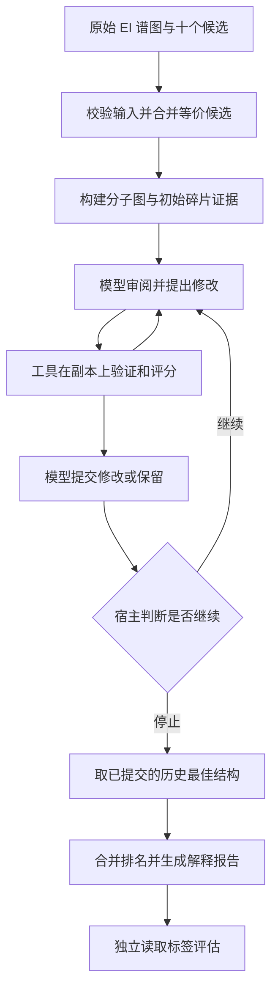

# GC–MS 科研 Agent

> **单仓库目录说明：** 本文中的“仓库根目录”均指 `GCMS-Agent/` 子目录。克隆总仓库后，先执行 `cd GCMS-Agent`，再运行本文命令；本地环境、配置及 `.env`（如使用）也位于此子目录。参见[项目总览](../README.zh-CN.md)。

[English](README.md) | **简体中文**

根据原始 EI 质谱审阅上游模型生成的十个候选 SMILES，在保持重原子组成的约束下提出结构修改，再由化学工具验证、评分和重新排序。输出包含候选结构、碎片证据、修改轨迹与解释报告。

模型通过 Claude Agent SDK/Harness 调用受控工具；Python 宿主负责图编辑、化学验证、评分、正式提交和停止判断。项目提供两种运行方式：

| 方式 | 做什么 | 运行条件 |
|---|---|---|
| `baseline` | 对输入候选进行确定性验证、评分和排序 | 无需 API 密钥，不调用模型或编辑结构 |
| `agent` | 模型审阅候选、试验修改并提交；宿主验证和保存结果 | 需要配置模型服务和 API 密钥，会产生调用费用 |

[真实案例](#真实案例过程展示) · [安装](#从零安装) · [离线示例](#运行公开示例) · [运行-agent](#运行-agent) · [技术文档](docs/README.md)

## 真实案例过程展示

无需安装即可阅读[案例导航](case_studies/README.md)。每例包含输入、独立参考标签、结构变化图、逐轮修改、全部工具试验、精简结果与来源校验。

| 案例 | 展示重点 | 历史结果边界 |
|---|---|---|
| [2,4-己二烯二腈](case_studies/hexa-2,4-dienedinitrile/README.md) | 多轮探索与历史最佳恢复 | 历史评分使用分箱强度；保存 Top1 命中，但整体未完成 |
| [丁酸正丁酯](case_studies/butyl-butanoate/README.md) | 服务失败、重试和参考结构生成 | 参考结构展示第 2；重试仍未完成 |
| [三甲基正戊基硅烷](case_studies/trimethylpentylsilane/README.md) | 含硅结构编辑与同分排名 | 参考结构展示第 6、证据并列第 1；未完成 |

三个主要 Agent 阶段保留 **62 条试验**，包括拒绝和未选中项，另记录初次服务失败。它们是获准公开的历史开发案例，保留原始评分和未完成状态，不作为当前版本准确率的证明。2,4-己二烯二腈的展示输入使用 `Agent-Harness/test.json` 中的原始强度，轨迹和排名来自历史分箱强度实验。

## 安装与快速开始

已验证环境：**Windows x86-64 / Python 3.10.19**。其他系统及 Python 版本尚未验证；`requires-python >=3.10` 是项目声明的最低版本，不代表所有较新版本的依赖组合均可安装。依赖定义见 [pyproject.toml](pyproject.toml)，[requirements.lock](requirements.lock) 固定 Windows / Python 3.10 的运行、测试及历史环境包版本。

请下载或克隆**完整仓库**并保留目录结构。本版本通过可编辑安装使用仓库中的 `configs/`、`skills/` 和 `resources/`；普通 wheel 安装尚未提供这些外部资源。移动仓库后需重新执行可编辑安装。

### 从零安装

在仓库根目录的 PowerShell 中执行。以下 `.venv` 应为新建目录；若已有研究环境，请选择新的环境路径，并相应替换后续命令。不要复用其他项目的环境，不要使用 `--system-site-packages`。

```powershell
# 安装 64 位 Python 3.10 后创建独立环境。
# 若没有 py 启动器，将 py -3.10 换成 Python 3.10 解释器的完整路径。
py -3.10 -m venv .venv
$env:PYTHONIOENCODING = 'utf-8'
$env:PYTHONDONTWRITEBYTECODE = '1'
# 清除当前进程可能指向旧项目的源码路径；不修改系统设置。
Remove-Item Env:PYTHONPATH -ErrorAction SilentlyContinue

# 首次安装需要访问 Python 包索引；不需要模型 API 密钥。
.\.venv\Scripts\python.exe -m pip install -r requirements.lock
.\.venv\Scripts\python.exe -m pip install -c requirements.lock -e ".[test]"

# 检查依赖与实际导入位置：应指向当前仓库的 src/gcms_agent。
.\.venv\Scripts\python.exe -m pip check
.\.venv\Scripts\python.exe -B -c "import gcms_agent; print(gcms_agent.__file__)"
.\.venv\Scripts\gcms-agent.exe --help
```

2026-11-18 安装验收：在 Windows / Python 3.10.19、不继承系统包的新环境中完成上述依赖与可编辑安装；`pip check`、命令行入口、398 项离线测试及两个公开人工示例的基线、绘图和评估均通过。验收时未设置 `PYTHONPATH`，未调用真实模型。

`[test]` 声明离线测试需要的 pytest；固定环境清单也包含它。Pillow 是生成结构图和公开案例图片的直接依赖。构建工具由 pip 单独解析，当前清单未锁定安装包哈希。

基线和离线测试无需运行模型。真实 Agent 运行还需要服务配置和 API 密钥；当前 Windows SDK 安装包带有原生 `claude.exe`，未设置 `cli_path` 时由 SDK 查找。自定义可执行文件的配置见 [configs/README.md](configs/README.md)。

### 运行公开示例

先完成安装，在仓库根目录的 PowerShell 中执行。两个[人工构造示例](data/examples/README.md)可直接体验流程，无需私有数据和 API 密钥。它们不是实测谱，也不用于衡量模型性能。每次运行使用尚不存在的输出目录。

```powershell
$env:PYTHONIOENCODING = 'utf-8'
$env:PYTHONDONTWRITEBYTECODE = '1'

# 对两条输入进行确定性评分，生成结构、证据和报告。
.\.venv\Scripts\python.exe -B -m gcms_agent.cli run data\examples\inference.json --mode baseline --output runs\public_example

# 运行结束后，单独读取标签评估；不要省略 --labels。
.\.venv\Scripts\python.exe -B -m gcms_agent.cli evaluate runs\public_example --labels data\examples\labels.json --input data\examples\inference.json

# 运行完整离线测试。
.\.venv\Scripts\python.exe -B -m pytest -q -p no:cacheprovider
```

运行结束后，先查看 `runs/public_example/reports/` 中的 Markdown 报告和 PNG 结构谱图，再查看 `results/` 中的排名及 `evaluation.json`。预期处理两条输入，每条保留十个来源槽位；等价候选共享计算，唯一结构数可以少于十个。

## 运行 Agent

完成离线示例后，可用同一人工输入检查真实模型流程。将 [.env.example](.env.example) 的内容复制到仓库根目录的本地 `.env`，填写 `DEEPSEEK_API_KEY`；若已有 `.env`，直接编辑，保留已有内容。也可以通过进程环境变量提供密钥，进程变量优先。

先核对 [model.yaml](configs/model.yaml) 的服务与模型设置。仓库当前记录 `deepseek-flash[1m]`、`thinking: true`、`effort: low`；服务可用性及实际计费需以你的服务账户为准。模型接入与 SDK 启动详见[配置说明](configs/README.md)。

```powershell
# 会调用真实模型。显式设置 10 元调度预算，使用新的输出目录。
.\.venv\Scripts\python.exe -B -m gcms_agent.cli run data\examples\inference.json --mode agent --output runs\public_agent_example --budget-cny 10

# 推理结束后独立评估，标签不交给推理模型。
.\.venv\Scripts\python.exe -B -m gcms_agent.cli evaluate runs\public_agent_example --labels data\examples\labels.json --input data\examples\inference.json

# 需要接续同一运行时使用；输入、配置及源码指纹须兼容。
.\.venv\Scripts\python.exe -B -m gcms_agent.cli resume data\examples\inference.json --output runs\public_agent_example --budget-cny 10
```

Agent 默认使用 `economy`，同一谱图最多并行两批。其 `offpeak_only: true` 会在本地配置判定的高峰时段停止启动新会话并记录 `offpeak_wait`，需要在允许时段显式恢复，不会后台定时续跑。基础配置默认不设总金额上限；示例中的预算是宿主调度估算，不是服务商的硬账单上限。详见[预算与调度](configs/README.md#调度预算与特殊值)及[恢复约定](docs/editing_and_stopping.md#resume)。

## 工作流程



以上为 Agent 路径；基线完成初始验证与评分后直接排序。模型使用 MoleCode 读取分子图，按候选 ID、图版本与原子 ID 提出操作。工具试验不会自动修改正式结果，提交后还需由宿主复核。

合法探索可以同分或降分；宿主分别保存当前探索图和已提交的历史最佳结果。非空最终结构需通过中性、连通、闭壳层、价态及往返检查，编辑保持各元素重原子数量与身份。协议、工具和验收细节见[系统架构](docs/architecture.md)、[分子契约](docs/molecode_contract.md)及[编辑与停止](docs/editing_and_stopping.md)。

## 输出文件

每次运行保存到独立的 `runs/<run_id>/`：

| 路径 | 内容 |
|---|---|
| `manifest.json`、`summary.json` | 输入、配置和版本指纹；运行完成情况 |
| `results/` | 十条来源结果、唯一结构排名、并列集合及解释质量 |
| `reports/` | 中文解释报告、候选 CSV 和结构谱图 |
| `evidence/` | 展示 Top1 的碎片证据 |
| `checkpoints/` | 候选状态、提交回执、试验记录及恢复信息 |
| `logs/budget.json` | 用量、已知或估算费用及预留记录 |
| `evaluation.json` | 执行独立 `evaluate` 后生成的评估结果 |

资源或服务中断时保留 `provisional/incomplete` 状态；未提交试验不会自动成为修复结果。审计包含未选中提案、错误、证据及分数，模型解释来自提交的摘要、理由和逐项说明，不保存隐藏思维正文。

## 输入、评分与使用边界

输入为原始 EI 质谱和十个候选，使用 `input_ids`、`intensity`、`generated` 与 `sample_id` 等字段。峰强保留原始线性尺度，不做基峰归一化、对数变换或重新分箱；旧 `position_ids` 格式拒绝进入当前运行流程。参考标签单独存放，仅在独立评估时使用。格式和自有数据准备见[数据说明](data/README.md)。

```text
score = 规则支持峰的原始强度之和 / 全部观测峰的原始强度之和
confidence_score = 100 × score
```

分数表示规则支持的强度覆盖率，**不是结构正确概率**。当前固定规则以名义 m/z 匹配并检查守恒，不预测碎片丰度；`verified=true` 表示工具检查通过，不代表实验确认了机制。当前无 RI 数据时不进行 RI 评分。规则范围（含 TMS 直接断裂及未覆盖机制）见 [EI 规则条件](resources/ei_rules/CONDITIONS.md)。

同一峰不因存在多条路径而重复计分。最高分并列时，来源候选数量及 canonical SMILES 次序用于选择展示 Top1，保留并列关系；展示次序不增加证据分，也不证明唯一身份。全部零分时不输出有支持的 Top1。完整定义和未完成运行的评估口径见[评分与评估](docs/scoring.md)。

完整研究数据及派生子集不随仓库发布；仅三个明确获准公开的历史案例作为例外。原始 `runs/`、凭据、缓存和本地生成产物继续保留本地。公开读者可使用人工示例运行项目，或阅读历史案例了解真实过程；两者均不构成独立性能基准。

## 目录与进一步阅读

| 目录 | 内容 |
|---|---|
| [src/gcms_agent/](src/gcms_agent/) | 化学工具、碎片证据、评分、Harness、工作流与报告 |
| [case_studies/](case_studies/README.md) | 三个获准公开案例的流程与轨迹 |
| [data/examples/](data/examples/README.md) | 可直接运行的人工输入和独立演示标签 |
| [configs/](configs/README.md) | 服务配置、运行参数、预算与调度 |
| [skills/](skills/README.md) | 模型技能、MoleCode 语法及按需参考 |
| [resources/](resources/README.md) | 固定 EI 规则、适用条件和来源 |
| [docs/](docs/README.md) | 架构、结构契约、编辑验收、评分及科学边界 |
| [scripts/](scripts/README.md) | 数据准备、验证、实验与案例导出脚本 |
| [tests/](tests/README.md) | 单元、集成及端到端离线验证 |

## 许可与第三方资料

本项目原创代码与说明文档采用 [MIT License](LICENSE)，版权署名为 `Copyright (c) 2026 刘昌霖`。允许商业使用、修改和再分发，使用时须保留版权及许可声明。

项目依赖并参考 Anthropic 的 Claude Agent SDK for Python；其 MIT 许可与版权声明另行保留。SDK 与 Claude Code CLI 的条款边界、MoleCode 来源及其他第三方材料见[第三方说明](THIRD_PARTY_NOTICES.md)。`case_studies/` 中三个真实案例的展示包不纳入上述代码与文档的 MIT 授权；其公开范围见[案例说明](case_studies/README.md)。私有研究数据不随仓库发布，详见[数据说明](data/README.md)。

本文按 2026-11-18 的代码与配置整理，默认参数以配置文件及其加载结果为准。
