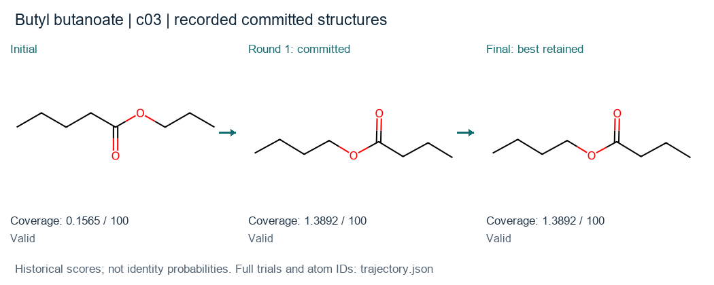

# Butyl butanoate: Service failure, retry, and generation of the reference structure

**English** | [简体中文](README.zh-CN.md)

The first Agent attempt stops because of a service error; the retry uses the same input and reference label. Focus candidate c03 commits the reference structure in its first round, but another structure has a slightly higher coverage score, placing the reference second in the saved display order. All source slots end with valid structures, yet the review remains incomplete when its session allowance is exhausted. Estimated costs for unknown usage in the initial failure remain separate from retry costs; counting only the retry does not establish a complete successful run.

This is an authorized historical development case, not a random test set or a new experiment with the current version. Model summaries, reasons, and operation explanations below remain in their original language (mostly Chinese), with only Markdown escaping applied. They are model-proposed explanations, not experimentally confirmed mechanisms. No model was rerun, chemical pathway revalidated, or score recalculated.

## Files and reading order

1. [Input](input.json): observed spectrum and ten original candidates. The [reference answer](reference.json) is stored separately for retrospective explanation and evaluation only.
2. This document: candidate sources, the focus trajectory, all trial entries, and the final status.
3. [Full structured trajectory](trajectory.json): initial graphs for every independently computed candidate, committed edit history, tool-call order within sessions, and all trials.
4. [Results and comparisons](result.json): every source slot, original rankings, per-stage evaluations, and costs with known or unknown usage.
5. [Provenance and checksums](provenance.json): historical configuration/source fingerprints, verification of the original frozen inventories, and SHA-256 checksums of public files.

## Input and version

Sample `s01055_907fc7efff69`, 46 spectral peaks, and 10 candidate source slots. Reference structure: `CCCCOC(=O)CCC`.
The input uses `raw_linear`. The current loader can validate its format, but historical code and skill versions differ from the current ones; reruns are not guaranteed to produce the same results.
These materials present the saved historical process. They are neither a resumable checkpoint nor a complete verbatim session transcript.

## Ten source slots

| Source | Independently computed candidate | Initial SMILES | Final SMILES | Stop reason |
|---|---|---|---|---|
| c01 | c01 | `CCC(=O)OCC(C)CC` | `CCCC(=O)OC(C)CC` | case_session_limit |
| c02 | c02 | `CCC(=O)OC(CC)CC` | `CCCC(=O)OC(C)CC` | case_session_limit |
| c03 | c03 | `CCCCC(=O)OCCC` | `CCCCOC(=O)CCC` | case_session_limit |
| c04 | c04 | `CCCCC.O=C1CCO1` | `CCCCOC(=O)CCC` | case_session_limit |
| c05 | c05 | `CC1CCCCOC(=O)C1` | `CCCCOC(=O)CCC` | case_session_limit |
| c06 | c06 | `CCCCCOC(=O)CC` | `CCCC(=O)OC(C)CC` | case_session_limit |
| c07 | c03 | `CCCCC(=O)OCCC` | `CCCCOC(=O)CCC` | case_session_limit |
| c08 | c01 | `CCC(=O)OCC(C)CC` | `CCCC(=O)OC(C)CC` | case_session_limit |
| c09 | c09 | `CCCC(C)OC(=O)CC` | `CCCC(=O)OC(C)CC` | case_session_limit |
| c10 | c04 | `CCCCC.O=C1CCO1` | `CCCCOC(=O)CCC` | case_session_limit |

Graphs and history are stored once per independently computed candidate. All ten source slots and their final states are retained.

## Focus structure trajectory

The figure focuses on `c03`. The initial state, each committed edit, and final output come from the original records. All coverage scores displayed in this document and figure are multiplied by 100.

### Round 1

Original model summary (not a confirmed mechanism): 重排为丁酸丁酯CCCCOC(=O)CCC，合法C8H16O2；工具支持116(McLafferty)与101，分数0.001565→0.013892，为当前最优；71/89/56等强峰与缺失的M+144仍为规则未覆盖的局限。

Committed: **Yes**; tool/host verdict: `valid_exploration`; coverage score: 1.389161.
Resulting structure: `CCCCOC(=O)CCC`.
Original model reason: 把丙基戊酸酯重排为丁酸丁酯（CCCCOC(=O)CCC）：丁酰基给出 m/z 116 的 McLafferty 离子（C6H12O2）及 101（C5H9O2），二者被工具路径支持；同时丁酰基（酸侧4碳直链，含γ-H）与丁氧基（醇侧4碳直链，有γ-H）分别对应144→116(C2H4)与→88(C4H8)的中性丢失，可解释观测到的116(12)、88(73)、101(59)，并与丁酰阳离子71(999)、丁烯56(484)、43(637)的直链特征一致。原丙基戊酸酯需要5碳戊酰基（预期85阳离子/102 McLafferty），与观测不符。分子离子144未出现、88/89/71/56/43/41/60等强峰仍无规则路径，属当前规则覆盖局限。

| Operation | Original model explanation |
|---|---|
| `{"op": "remove_bond", "a": "Mol_C_4", "b": "Mol_C_5"}` | 断开 Mol_C_4–Mol_C_5（C5为羰基碳），把 C4 从酸侧戊酰链移出 |
| `{"op": "remove_bond", "a": "Mol_C_3", "b": "Mol_C_4"}` | 断开 Mol_C_3–Mol_C_4，为 C4 改接到醇侧末端 C8 腾出价位 |
| `{"op": "set_bond", "a": "Mol_C_3", "b": "Mol_C_5", "order": 1}` | 新成 Mol_C_3–Mol_C_5 单键，使酸侧变为 C5–C3–C2–C1 的丁酰基（4碳） |
| `{"op": "set_bond", "a": "Mol_C_4", "b": "Mol_C_8", "order": 1}` | 新成 Mol_C_4–Mol_C_8 单键，使醇侧变为 O2–C6–C7–C8–C4 的丁氧基（4碳） |
| `{"op": "set_atom", "id": "Mol_C_4", "hydrogens": 3}` | Mol_C_4 现只连 C8，氢数 2→3（CH2→CH3） |
| `{"op": "set_atom", "id": "Mol_C_8", "hydrogens": 2}` | Mol_C_8 现连 C7 与 C4，氢数 3→2（CH3→CH2）；总氢16、C8H16O2 |

### Round 2

Original model summary (not a confirmed mechanism): 保留正丁酸丁酯 CCCCOC(=O)CCC（C8H16O2，M=144）。谱图与丁酸酯骨架一致但规则覆盖率低：M+ 144 未观测，116（M-28）、101（M-43）由 mclafferty/carbonyl_alpha/heteroatom_alpha 支持，而最强峰 71、43、89、56、41 无对应规则路径（71 权重 0.195、43 0.125、89 0.112、56 0.095、41 0.091，约 98.6% 强度未分配），属规则集缺少酯 α-断裂/酰基离子通道的覆盖局限。已试两个有依据的替代：异丁酸丁酯（同分 0.01389，无新增支持峰）与仲丁酸丁酯（0.01487，仅新增 m/z 115，强度 5）。仲丁基的独特通道 115 极弱，而共享的 101（强度 59）与强峰 56（484）&gt; 57（167）更符合直链正丁基而非仲丁基/异丁基，且分数提升仅来自强度 5 的弱峰，不构成可核验的结构改进，故不采纳编辑。

## All tool trials

Entries follow receipt-file order and the order within each receipt; this does not establish an exact chronology across concurrent sessions. A selected tool reference is not necessarily a host commit. Committed state changes are identified by `committed` in candidate `rounds`.

| Session | Candidate / graph version | Trial ID | Valid | Tool verdict | Reference selected | Coverage score |
|---|---|---|---|---|---|---|
| 1 | c01 / 0 | `t_c809c7ea08e3555066ae2be7` | True | valid_exploration | True | 1.389161 |
| 1 | c02 / 0 | `t_59742937fb0f4cae70fe6d5f` | True | valid_exploration | True | 1.389161 |
| 1 | c01 / 0 | `t_23e55a0c4515edbd718ba993` | True | valid_exploration | False | 1.154373 |
| 2 | c03 / 0 | `t_cd7ff702157e93d3f4fa5e29` | True | valid_exploration | True | 1.389161 |
| 2 | c03 / 0 | `t_4a09f180f38f0708b324455b` | True | valid_exploration | False | 1.389161 |
| 2 | c04 / 0 | `t_4561c19f397cdb61ba516a79` | True | first_valid_repair | True | 1.389161 |
| 2 | c04 / 0 | `t_9d7ab6f6468837b8fedd6cc6` | True | first_valid_repair | False | 1.389161 |
| 3 | c05 / 0 | `t_c47b4429542db045e9d78191` | True | valid_exploration | True | 1.389161 |
| 3 | c05 / 0 | `t_3523536148afef3c659d49db` | True | valid_exploration | False | 2.054392 |
| 3 | c06 / 0 | `t_8f926245421967d6a26bf361` | True | valid_exploration | True | 1.389161 |
| 3 | c06 / 0 | `t_c5b28d7cce4db1f6dd1d17c8` | True | valid_exploration | True | 1.486989 |
| 4 | c09 / 0 | `t_39df86e864a45b4b54af00f5` | True | valid_exploration | False | 1.389161 |
| 4 | c09 / 0 | `t_8603bcd9ee4cc7f8006f2477` | True | valid_exploration | True | 1.486989 |
| 5 | c01 / 1 | `t_6faf4222c6ef3cbc4fdd28d3` | True | valid_exploration | False | 1.154373 |
| 5 | c01 / 1 | `t_fad7a998fa233b82d0f0f52f` | True | valid_exploration | False | 1.389161 |
| 5 | c01 / 1 | `t_094f80f329db7b420fd2bf24` | True | valid_exploration | True | 1.486989 |
| 6 | c02 / 1 | `t_c8142684172a123c5af54ea7` | True | valid_exploration | False | 1.389161 |
| 6 | c02 / 1 | `t_5177b5cb360ab95df01f4b81` | True | valid_exploration | False | 0.097828 |
| 6 | c02 / 1 | `t_c4008b8f8e2397da6b8eb126` | True | valid_exploration | False | 1.252201 |
| 6 | c02 / 1 | `t_3af7898fa411e48bc014e638` | True | valid_exploration | True | 1.486989 |
| 6 | c02 / 1 | `t_d4338d6b618f64fb96a6c337` | False | chemical_validation_failed | False | Not scored |
| 6 | c02 / 1 | `t_b4e0012670182b85e6b31605` | True | valid_exploration | False | 0.097828 |
| 6 | c02 / 1 | `t_a01052a2946822dc5ceeb2ca` | True | valid_exploration | False | 1.389161 |
| 6 | c02 / 1 | `t_f67df3955fc4ed06b924157f` | True | valid_exploration | False | 0.097828 |
| 7 | c03 / 1 | `t_373b5ea08290ac50c6ebd430` | True | valid_exploration | False | 1.389161 |
| 7 | c03 / 1 | `t_80b6b351e7265175f0733597` | True | valid_exploration | False | 1.486989 |

## Results by stage

| Stage | Complete | Saved ranking Acc@1 / Acc@10 | Strict end-to-end Acc@1 / Acc@10 | Known / estimated cost (CNY) |
|---|---|---|---|---|
| initial_baseline | True | 0.0 / 0.0 | 0.0 / 0.0 | 0.00000000 / 0.00000000 |
| initial_agent | False | 0.0 / 0.0 | 0.0 / 0.0 | 0.00000000 / 0.14553600 |
| retry_baseline | True | 0.0 / 0.0 | 0.0 / 0.0 | 0.00000000 / 0.00000000 |
| agent | False | 0.0 / 1.0 | 0.0 / 0.0 | 0.81609360 / 0.00000000 |

### Final saved order of unique structures

| Display position | Evidence rank | SMILES | Coverage score | Reference structure |
|---|---|---|---|---|
| 1 | 1 | `CCCC(=O)OC(C)CC` | 1.486989 | No |
| 2 | 2 | `CCCCOC(=O)CCC` | 1.389161 | Yes |

## How to interpret these materials

All main Agent runs are provisional/incomplete. Generating the reference structure, selecting Top1, and completing the entire review are distinct outcomes. Strict end-to-end evaluation counts incomplete cases as misses; individual development cases do not establish overall identification accuracy or cost.
The trajectory uses content-addressed object pools (`graphs`, `scores`, and `paths`), deduplicated by SHA-256. Resolve `graph_ref`, `score_ref`, and `path_refs` within the same `trajectory.json`. Atom IDs and graph versions are preserved; atom correspondence is not reconstructed from canonical SMILES.
Input and labels retain the semantics of their source files. Public trajectories are derived materials with selected fields and deduplicated objects. `provenance.json` records public-file hashes separately. The original frozen inventories show that local source files passed verification at export time; public files are not byte-for-byte copies of the complete original results.
Only recorded tool-call metadata, trials, and submitted explanations are included. Hidden reasoning text, raw session streams, credentials, personal paths, and CLI caches are excluded. Unrecorded reasoning cannot be reconstructed from these summaries.
The bundle contains recorded fingerprints, not the complete historical source code. It does not provide all conditions needed to reproduce historical model experiments byte for byte.

Return to the [case-study index](../README.md).
