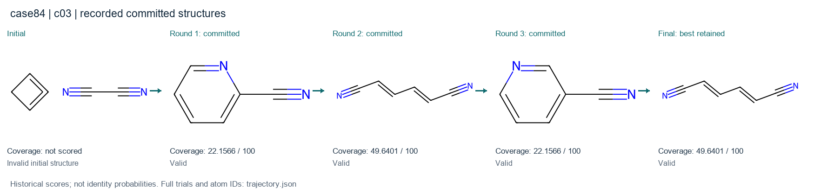

# case84: Multi-round exploration and retention of the historical best

**English** | [简体中文](README.md)

Candidate c03 starts from a disconnected graph, first forms a valid cyclic structure, then reaches the reference structure, and subsequently explores a lower-scoring structure. The final output restores the earlier historical best rather than returning the last explored graph. The reference is first in the saved historical ranking, but the case remains incomplete. Legacy binned intensities and the historical scoring range are preserved: no linear-intensity conversion or reranking under current source-vote rules is applied.

This is an authorized historical development case, not a random test set or a new experiment with the current version. Model summaries, reasons, and operation explanations below remain in their original language (mostly Chinese), with only Markdown escaping applied. They are model-proposed explanations, not experimentally confirmed mechanisms. No model was rerun, chemical pathway revalidated, or score recalculated.

## Files and reading order

1. [Input](input.json): observed spectrum and ten original candidates. The [reference answer](reference.json) is stored separately for retrospective explanation and evaluation only.
2. This document: candidate sources, the focus trajectory, all trial entries, and the final status.
3. [Full structured trajectory](trajectory.json): initial graphs for every independently computed candidate, committed edit history, tool-call order within sessions, and all trials.
4. [Results and comparisons](result.json): every source slot, original rankings, per-stage evaluations, and costs with known or unknown usage.
5. [Provenance and checksums](provenance.json): historical configuration/source fingerprints, verification of the original frozen inventories, and SHA-256 checksums of public files.

## Input and version

Sample `s00084_b561c4feb886`, 43 spectral peaks, and 10 candidate source slots. Reference structure: `N#CC=CC=CC#N`.
**Legacy binned input**: `position_ids` retains its historical encoding. The current CLI explicitly rejects this format; renaming the field does not make it runnable.
These materials present the saved historical process. They are neither a resumable checkpoint nor a complete verbatim session transcript.

## Ten source slots

| Source | Independently computed candidate | Initial SMILES | Final SMILES | Stop reason |
|---|---|---|---|---|
| c01 | c01 | `N#Cc1cccnc1` | `N#Cc1cccnc1` | review_complete |
| c02 | c02 | `N#Cc1ccccn1` | `N#Cc1ccccn1` | review_complete |
| c03 | c03 | `C1=CCC=1.N#CC#N` | `N#CC=CC=CC#N` | max_rounds |
| c04 | c04 | `N#CCc1cccn1` | `N#Cc1ccncc1` | review_complete |
| c05 | c01 | `N#Cc1cccnc1` | `N#Cc1cccnc1` | review_complete |
| c06 | c01 | `N#Cc1cccnc1` | `N#Cc1cccnc1` | review_complete |
| c07 | c07 | `N#Cc1cc(C#N)c1` | `N#CC=CC=CC#N` | review_complete |
| c08 | c08 | `Cc1cc(C#N)cn1` | `N#CC=CC=CC#N` | case_session_limit |
| c09 | c01 | `N#Cc1cccnc1` | `N#Cc1cccnc1` | review_complete |
| c10 | c10 | `N#CCc1ccnc1` | `N#Cc1cccnc1` | case_session_limit |

Graphs and history are stored once per independently computed candidate. All ten source slots and their final states are retained.

## Focus structure trajectory

The figure focuses on `c03`. The initial state, each committed edit, and final output come from the original records. All coverage scores displayed in this document and figure are multiplied by 100.

### Round 1

Original model summary (not a confirmed mechanism): c03 原图断开非法；按 M=104 与 m/z 77 提示重排为 2-氰基吡啶，工具验证合法且支持 104/78 峰。

Committed: **Yes**; tool/host verdict: `first_valid_repair`; coverage score: 22.156588.
Resulting structure: `N#Cc1ccccn1`.
Original model reason: 原图虽为 C6H4N2（M=104）但分成两个连通分量；同一原子组重排为 2-氰基吡啶，得合法 C6H4N2，并支持 104/78 峰。

| Operation | Original model explanation |
|---|---|
| `{"op": "set_bond", "a": "Mol_C_1", "b": "Mol_C_2", "order": 1}` | C1=C2 改单键：C1 改接 N1=C1 与 C1–C6，仍为四价 |
| `{"op": "set_bond", "a": "Mol_C_2", "b": "Mol_C_3", "order": 2}` | C2–C3 改双键：形成吡啶环 Kekulé 交替 |
| `{"op": "remove_bond", "a": "Mol_C_4", "b": "Mol_C_1"}` | 删除 C4=C1：C1 不再作四元环成员 |
| `{"op": "set_bond", "a": "Mol_C_4", "b": "Mol_C_5", "order": 2}` | 新建 C4=C5 双键：闭合六元环，C4 保留 1 H |
| `{"op": "set_bond", "a": "Mol_N_1", "b": "Mol_C_5", "order": 1}` | N1≡C5 三键降为单键：环内 N1–C5 |
| `{"op": "remove_bond", "a": "Mol_C_5", "b": "Mol_C_6"}` | 删除 C5–C6：C6 改为腈基碳接 C1 |
| `{"op": "set_bond", "a": "Mol_N_1", "b": "Mol_C_1", "order": 2}` | 新建 N1=C1 双键：环内吡啶型 N 三价 |
| `{"op": "set_bond", "a": "Mol_C_1", "b": "Mol_C_6", "order": 1}` | 新建 C1–C6 单键：保留 C6≡N2 腈基 |
| `{"op": "set_atom", "id": "Mol_C_3", "hydrogens": 1}` | C3 由 CH2 改 CH（双键 2+单键 1=3 价） |
| `{"op": "set_atom", "id": "Mol_C_5", "hydrogens": 1}` | C5 由 C 改 CH（C4=C5 2+N1 单键 1=3 价） |

### Round 2

Original model summary (not a confirmed mechanism): 2-氰基吡啶合法但最强峰 77 无规则路径；开链共轭二腈结构合法且支持 77 与 104，得分 0.4964（0.435–0.558）为历史新高。78/51/50/64 仍未解释，芳香腈 HCN 丢失未被规则覆盖，故吡啶腈异构体可能被低估，本替代仅作待验证假说。

Committed: **Yes**; tool/host verdict: `valid_exploration`; coverage score: 49.640091.
Resulting structure: `N#CC=CC=CC#N`.
Original model reason: 原 2-氰基吡啶仅支持 M⁺104 与 M–CN 78，谱中最强峰 m/z 77（权重 0.308）无规则路径。改为开链共轭二腈后化学合法，vinyl_nitrile_hcn_loss 于 77 给出两条 C5H3N 路径（e2 断 Mol_C_1–Mol_C_6，e3 断 Mol_C_4–Mol_C_5），同时保留 M⁺104；得分升至 0.496（0.435–0.558）。

| Operation | Original model explanation |
|---|---|
| `{"op": "remove_bond", "a": "Mol_N_1", "b": "Mol_C_1"}` | 断开 Mol_N_1–Mol_C_1 环键，六元环开环为链 |
| `{"op": "set_bond", "a": "Mol_C_1", "b": "Mol_C_2", "order": 2}` | Mol_C_1=Mol_C_2 设为双键（原为单键） |
| `{"op": "set_bond", "a": "Mol_C_2", "b": "Mol_C_3", "order": 1}` | Mol_C_2–Mol_C_3 降为单键（原为双键） |
| `{"op": "set_bond", "a": "Mol_C_3", "b": "Mol_C_4", "order": 2}` | Mol_C_3=Mol_C_4 升为双键（原为单键） |
| `{"op": "set_bond", "a": "Mol_C_4", "b": "Mol_C_5", "order": 1}` | Mol_C_4–Mol_C_5 降为单键（原为双键） |
| `{"op": "set_bond", "a": "Mol_C_5", "b": "Mol_N_1", "order": 3}` | Mol_C_5≡Mol_N_1 设为三键，N_1 成为腈基氮 |
| `{"op": "set_atom", "id": "Mol_C_1", "hydrogens": 1}` | Mol_C_1 补 1 个显式氢：与 C_6 单键、与 C_2 双键，满足四价 |
| `{"op": "set_atom", "id": "Mol_C_5", "hydrogens": 0}` | Mol_C_5 撤 1 个显式氢：与 C_4 单键、与 N_1 三键，满足四价 |

### Round 3

Original model summary (not a confirmed mechanism): 当前 c03 图 N#CC=CC=CC#N 合法，104(M+) 与 77(HCN 丢失) 路径支持、分 0.4964 为历史最佳。已试验未见过的吡啶-3-/4-甲腈两个环化异构体：均合法，仅支持 104 与 78(芳基腈脱 CN)，分 0.2216，未超过历史最佳；77 强峰未获环化规则覆盖，属规则缺口而非否定。保留历史最佳非环二烯腈。

Committed: **Yes**; tool/host verdict: `valid_exploration`; coverage score: 22.156588.
Resulting structure: `N#Cc1cccnc1`.
Original model reason: 环化异构体对照：闭合吡啶环形成吡啶-3-甲腈，检验 104(M+) 与 78(M-CN) 谱系是否为环化结构特征；77 强峰在本试验中无工具路径，仅作待验证假说。

| Operation | Original model explanation |
|---|---|
| `{"op": "remove_bond", "a": "Mol_C_5", "b": "Mol_N_1"}` | 拆除 C5≡N1 旧腈基三键 |
| `{"op": "remove_bond", "a": "Mol_C_6", "b": "Mol_N_2"}` | 拆除 C6≡N2 端基腈三键，释放环氮 N2 |
| `{"op": "remove_bond", "a": "Mol_C_1", "b": "Mol_C_6"}` | 断开 C1-C6 连接，使 C6 改作环上腈基 |
| `{"op": "set_bond", "a": "Mol_C_2", "b": "Mol_C_6", "order": 1}` | C6 单键接到 C2（吡啶 3 位） |
| `{"op": "set_bond", "a": "Mol_C_6", "b": "Mol_N_1", "order": 3}` | 重建 C6≡N1 腈基三键 |
| `{"op": "set_bond", "a": "Mol_C_5", "b": "Mol_N_2", "order": 2}` | 形成环内 C5=N2 双键 |
| `{"op": "set_bond", "a": "Mol_N_2", "b": "Mol_C_1", "order": 1}` | 闭合 N2-C1 单键，完成六元芳环 Kekulé 结构 |
| `{"op": "set_atom", "id": "Mol_C_2", "hydrogens": 0}` | C2 由 CH 改为 C（H=0），配平新增 C6 单键 |
| `{"op": "set_atom", "id": "Mol_C_5", "hydrogens": 1}` | C5 由 C（H=0）改为 CH（H=1），配平环内双键 |

Committed: **No**; tool/host verdict: `valid_exploration`; coverage score: 22.156588.
Resulting structure: `N#Cc1ccncc1`.
Original model reason: 环化异构体对照：闭合吡啶环形成吡啶-4-甲腈，与 3-位异构体同等检验 104/78 谱系；77 强峰在本试验中无工具路径，仅作待验证假说。

| Operation | Original model explanation |
|---|---|
| `{"op": "remove_bond", "a": "Mol_C_5", "b": "Mol_N_1"}` | 拆除 C5≡N1 旧腈基三键 |
| `{"op": "remove_bond", "a": "Mol_C_6", "b": "Mol_N_2"}` | 拆除 C6≡N2 端基腈三键，释放环氮 N2 |
| `{"op": "remove_bond", "a": "Mol_C_1", "b": "Mol_C_6"}` | 断开 C1-C6 连接，使 C6 改作环上腈基 |
| `{"op": "set_bond", "a": "Mol_C_3", "b": "Mol_C_6", "order": 1}` | C6 单键接到 C3（吡啶 4 位） |
| `{"op": "set_bond", "a": "Mol_C_6", "b": "Mol_N_1", "order": 3}` | 重建 C6≡N1 腈基三键 |
| `{"op": "set_bond", "a": "Mol_C_5", "b": "Mol_N_2", "order": 2}` | 形成环内 C5=N2 双键 |
| `{"op": "set_bond", "a": "Mol_N_2", "b": "Mol_C_1", "order": 1}` | 闭合 N2-C1 单键，完成六元芳环 Kekulé 结构 |
| `{"op": "set_atom", "id": "Mol_C_3", "hydrogens": 0}` | C3 由 CH 改为 C（H=0），配平新增 C6 单键 |
| `{"op": "set_atom", "id": "Mol_C_5", "hydrogens": 1}` | C5 由 C（H=0）改为 CH（H=1），配平环内双键 |

## All tool trials

Entries follow receipt-file order and the order within each receipt; this does not establish an exact chronology across concurrent sessions. A selected tool reference is not necessarily a host commit. Committed state changes are identified by `committed` in candidate `rounds`.

| Session | Candidate / graph version | Trial ID | Valid | Tool verdict | Reference selected | Coverage score |
|---|---|---|---|---|---|---|
| 1 | c01 / 0 | `t_0ee67981d1b7fa45c9f9724f` | True | valid_exploration | False | 22.156588 |
| 1 | c02 / 0 | `t_c6154037c609869b40afd973` | True | valid_exploration | False | 22.156588 |
| 2 | c03 / 0 | `t_a415bc2cee4b809eb78bc15c` | True | first_valid_repair | True | 22.156588 |
| 2 | c04 / 0 | `t_e378bfbb1759b35c12fc11e2` | True | first_valid_repair | True | 22.156588 |
| 2 | c07 / 0 | `t_891b6241928add9ed1d89224` | True | valid_exploration | True | 22.156588 |
| 3 | c08 / 0 | `t_4b91a4ecfc38cdd3f88a8d91` | True | first_valid_repair | True | 22.156588 |
| 3 | c10 / 0 | `t_31cf4edfd3a3c4b2b9f387ee` | True | first_valid_repair | True | 22.156588 |
| 3 | c10 / 0 | `t_a881a4607d22c81ea0439248` | True | first_valid_repair | True | 22.156588 |
| 4 | c03 / 1 | `t_cf240b60dd53f2257a6b8dec` | True | valid_exploration | True | 49.640091 |
| 4 | c04 / 1 | `t_3bf732528fc24412604b5ba5` | True | valid_exploration | False | 22.156588 |
| 5 | c07 / 1 | `t_90631f9c3154453e33090a4a` | False | chemical_validation_failed | False | Not scored |
| 5 | c08 / 1 | `t_d8764900b8def72b529b915c` | True | valid_exploration | False | 22.156588 |
| 5 | c08 / 1 | `t_6464ec24200ca31d24336805` | True | valid_exploration | False | 22.156588 |
| 5 | c07 / 1 | `t_a82f51ba688adede28d736f9` | True | valid_exploration | True | 49.640091 |
| 5 | c08 / 1 | `t_9970e89079db5262a7b9f79b` | True | valid_exploration | True | 49.640091 |
| 6 | c10 / 1 | `t_52387c8b7785825c1700a9ca` | True | valid_exploration | True | 22.156588 |
| 7 | c03 / 2 | `t_038abd62967ac58a8efc3080` | True | valid_exploration | True | 22.156588 |
| 7 | c03 / 2 | `t_4f7f6bf6f78de93086f1a657` | True | valid_exploration | True | 22.156588 |
| 8 | c07 / 2 | `t_3ce62f4fd1e6fb22d36a2347` | True | valid_exploration | False | 22.156588 |
| 8 | c07 / 2 | `t_24f0e9433846bd135b0d4ebb` | False | chemical_validation_failed | False | Not scored |

## Results by stage

| Stage | Complete | Saved ranking Acc@1 / Acc@10 | Strict end-to-end Acc@1 / Acc@10 | Known / estimated cost (CNY) |
|---|---|---|---|---|
| agent | False | 1.0 / 1.0 | 0.0 / 0.0 | 0.81380196 / 0.00000000 |

### Final saved order of unique structures

| Display position | Evidence rank | SMILES | Coverage score | Reference structure |
|---|---|---|---|---|
| 1 | 1 | `N#CC=CC=CC#N` | 49.640091 | Yes |
| 2 | 2 | `N#Cc1ccccn1` | 22.156588 | No |
| 3 | 2 | `N#Cc1cccnc1` | 22.156588 | No |
| 4 | 2 | `N#Cc1ccncc1` | 22.156588 | No |

## How to interpret these materials

All main Agent runs are provisional/incomplete. Generating the reference structure, selecting Top1, and completing the entire review are distinct outcomes. Strict end-to-end evaluation counts incomplete cases as misses; individual development cases do not establish overall identification accuracy or cost.
The trajectory uses content-addressed object pools (`graphs`, `scores`, and `paths`), deduplicated by SHA-256. Resolve `graph_ref`, `score_ref`, and `path_refs` within the same `trajectory.json`. Atom IDs and graph versions are preserved; atom correspondence is not reconstructed from canonical SMILES.
Input and labels retain the semantics of their source files. Public trajectories are derived materials with selected fields and deduplicated objects. `provenance.json` records public-file hashes separately. The original frozen inventories show that local source files passed verification at export time; public files are not byte-for-byte copies of the complete original results.
Only recorded tool-call metadata, trials, and submitted explanations are included. Hidden reasoning text, raw session streams, credentials, personal paths, and CLI caches are excluded. Unrecorded reasoning cannot be reconstructed from these summaries.
The bundle contains recorded fingerprints, not the complete historical source code. It does not provide all conditions needed to reproduce historical model experiments byte for byte.

Return to the [case-study index](../README.en.md).
