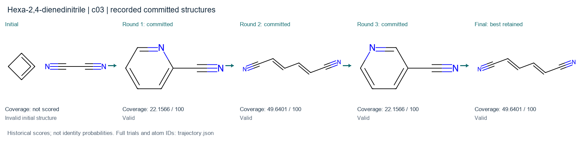

# 2,4-己二烯二腈：多轮探索与历史最佳保留

[English](README.en.md) | **简体中文**

c03 从断开的初始图开始，先形成合法环状结构，再得到参考结构，随后仍探索了更低分结构。最终恢复较早的历史最佳，而不是直接输出最后探索图。旧版保存排名中参考结构位于第 1，但整例仍未完成。历史运行使用分箱强度，轨迹、评分区间和排名均取自该次运行。

这是获准公开的历史开发案例，不是随机测试集或当前版本的新实验。模型文字按原记录保留，为模型提出的解释，不代表实验确认的机理。未重新运行模型、验证化学路径或重算分数。

## 文件与阅读顺序

1. [输入](input.json)：观测谱与十个原始候选；[参考答案](reference.json)独立保存，仅用于事后说明与评估。
2. 本文：候选来源、关键轨迹、全部试验索引及最终状态。
3. [完整结构化轨迹](trajectory.json)：所有独立候选的初始图、正式提交历史、会话工具顺序和全部试验。
4. [结果与对照](result.json)：全部来源槽位、原始排名、各阶段评估及已知/未知费用。
5. [来源与校验](provenance.json)：历史配置/源码指纹、原冻结清单验证与公开文件 SHA-256。

## 输入与版本

样本 `s00084_b561c4feb886`，43 个谱峰，10 个候选来源槽位。参考结构：`N#CC=CC=CC#N`。
展示输入的 `input_ids` 和 `intensity` 按位置一一对应。43 个峰的原始线性强度取自 `Agent-Harness/test.json`，保留源文件尺度（基峰 m/z 77 为 999，m/z 104 为 538）。历史运行使用 `position_ids` 分箱强度。
本材料展示已保存的历史过程，不是可恢复检查点或完整会话逐字记录。

## 十个来源槽位

| 来源 | 独立计算候选 | 初始 SMILES | 最终 SMILES | 结束原因 |
|---|---|---|---|---|
| c01 | c01 | `N#Cc1cccnc1` | `N#Cc1cccnc1` | review_complete |
| c02 | c02 | `N#Cc1ccccn1` | `N#Cc1ccccn1` | review_complete |
| c03 | c03 | `C1=CCC=1.N#CC#N` | `N#CC=CC=CC#N` | max_rounds |
| c04 | c04 | `N#CCc1cccn1` | `N#Cc1ccncc1` | review_complete |
| c05 | c01 | `N#Cc1cccnc1` | `N#Cc1cccnc1` | review_complete |
| c06 | c01 | `N#Cc1cccnc1` | `N#Cc1cccnc1` | review_complete |
| c07 | c07 | `N#Cc1cc(C#N)c1` | `N#CC=CC=CC#N` | review_complete |
| c08 | c08 | `Cc1cc(C#N)cn1` | `N#CC=CC=CC#N` | case_session_limit |
| c09 | c01 | `N#Cc1cccnc1` | `N#Cc1cccnc1` | review_complete |
| c10 | c10 | `N#CCc1ccnc1` | `N#Cc1cccnc1` | case_session_limit |

同一独立计算候选的图与历史只存一份，十个来源槽位及其最终状态全部保留。

## 关键结构轨迹

图中只突出 `c03`；初始状态、每次正式提交与最终输出均来自原记录。图上数值是覆盖分 × 100。

### 第 1 轮

模型提交摘要（未经机理确证）：c03 原图断开非法；按 M=104 与 m/z 77 提示重排为 2-氰基吡啶，工具验证合法且支持 104/78 峰。

正式提交：**是**；工具/宿主结论：`first_valid_repair`；覆盖分：22.156588。
结果结构：`N#Cc1ccccn1`。
模型理由：原图虽为 C6H4N2（M=104）但分成两个连通分量；同一原子组重排为 2-氰基吡啶，得合法 C6H4N2，并支持 104/78 峰。。

| 操作 | 模型逐项说明 |
|---|---|
| `{"op": "set_bond", "a": "Mol_C_1", "b": "Mol_C_2", "order": 1}` | C1=C2 改单键：C1 改接 N1=C1 与 C1–C6，仍为四价 |
| `{"op": "set_bond", "a": "Mol_C_2", "b": "Mol_C_3", "order": 2}` | C2–C3 改双键：形成吡啶环 Kekulé 交替 |
| `{"op": "remove_bond", "a": "Mol_C_4", "b": "Mol_C_1"}` | 删除 C4=C1：C1 不再作四元环成员 |
| `{"op": "set_bond", "a": "Mol_C_4", "b": "Mol_C_5", "order": 2}` | 新建 C4=C5 双键：闭合六元环，C4 保留 1 H |
| `{"op": "set_bond", "a": "Mol_N_1", "b": "Mol_C_5", "order": 1}` | N1≡C5 三键降为单键：环内 N1–C5 |
| `{"op": "remove_bond", "a": "Mol_C_5", "b": "Mol_C_6"}` | 删除 C5–C6：C6 改为腈基碳接 C1 |
| `{"op": "set_bond", "a": "Mol_N_1", "b": "Mol_C_1", "order": 2}` | 新建 N1=C1 双键：环内吡啶型 N 三价 |
| `{"op": "set_bond", "a": "Mol_C_1", "b": "Mol_C_6", "order": 1}` | 新建 C1–C6 单键：保留 C6≡N2 腈基 |
| `{"op": "set_atom", "id": "Mol_C_3", "hydrogens": 1}` | C3 由 CH2 改 CH（双键 2+单键 1=3 价） |
| `{"op": "set_atom", "id": "Mol_C_5", "hydrogens": 1}` | C5 由 C 改 CH（C4=C5 2+N1 单键 1=3 价） |

### 第 2 轮

模型提交摘要（未经机理确证）：2-氰基吡啶合法但最强峰 77 无规则路径；开链共轭二腈结构合法且支持 77 与 104，得分 0.4964（0.435–0.558）为历史新高。78/51/50/64 仍未解释，芳香腈 HCN 丢失未被规则覆盖，故吡啶腈异构体可能被低估，本替代仅作待验证假说。

正式提交：**是**；工具/宿主结论：`valid_exploration`；覆盖分：49.640091。
结果结构：`N#CC=CC=CC#N`。
模型理由：原 2-氰基吡啶仅支持 M⁺104 与 M–CN 78，谱中最强峰 m/z 77（权重 0.308）无规则路径。改为开链共轭二腈后化学合法，vinyl_nitrile_hcn_loss 于 77 给出两条 C5H3N 路径（e2 断 Mol_C_1–Mol_C_6，e3 断 Mol_C_4–Mol_C_5），同时保留 M⁺104；得分升至 0.496（0.435–0.558）。。

| 操作 | 模型逐项说明 |
|---|---|
| `{"op": "remove_bond", "a": "Mol_N_1", "b": "Mol_C_1"}` | 断开 Mol_N_1–Mol_C_1 环键，六元环开环为链 |
| `{"op": "set_bond", "a": "Mol_C_1", "b": "Mol_C_2", "order": 2}` | Mol_C_1=Mol_C_2 设为双键（原为单键） |
| `{"op": "set_bond", "a": "Mol_C_2", "b": "Mol_C_3", "order": 1}` | Mol_C_2–Mol_C_3 降为单键（原为双键） |
| `{"op": "set_bond", "a": "Mol_C_3", "b": "Mol_C_4", "order": 2}` | Mol_C_3=Mol_C_4 升为双键（原为单键） |
| `{"op": "set_bond", "a": "Mol_C_4", "b": "Mol_C_5", "order": 1}` | Mol_C_4–Mol_C_5 降为单键（原为双键） |
| `{"op": "set_bond", "a": "Mol_C_5", "b": "Mol_N_1", "order": 3}` | Mol_C_5≡Mol_N_1 设为三键，N_1 成为腈基氮 |
| `{"op": "set_atom", "id": "Mol_C_1", "hydrogens": 1}` | Mol_C_1 补 1 个显式氢：与 C_6 单键、与 C_2 双键，满足四价 |
| `{"op": "set_atom", "id": "Mol_C_5", "hydrogens": 0}` | Mol_C_5 撤 1 个显式氢：与 C_4 单键、与 N_1 三键，满足四价 |

### 第 3 轮

模型提交摘要（未经机理确证）：当前 c03 图 N#CC=CC=CC#N 合法，104(M+) 与 77(HCN 丢失) 路径支持、分 0.4964 为历史最佳。已试验未见过的吡啶-3-/4-甲腈两个环化异构体：均合法，仅支持 104 与 78(芳基腈脱 CN)，分 0.2216，未超过历史最佳；77 强峰未获环化规则覆盖，属规则缺口而非否定。保留历史最佳非环二烯腈。

正式提交：**是**；工具/宿主结论：`valid_exploration`；覆盖分：22.156588。
结果结构：`N#Cc1cccnc1`。
模型理由：环化异构体对照：闭合吡啶环形成吡啶-3-甲腈，检验 104(M+) 与 78(M-CN) 谱系是否为环化结构特征；77 强峰在本试验中无工具路径，仅作待验证假说。。

| 操作 | 模型逐项说明 |
|---|---|
| `{"op": "remove_bond", "a": "Mol_C_5", "b": "Mol_N_1"}` | 拆除 C5≡N1 旧腈基三键 |
| `{"op": "remove_bond", "a": "Mol_C_6", "b": "Mol_N_2"}` | 拆除 C6≡N2 端基腈三键，释放环氮 N2 |
| `{"op": "remove_bond", "a": "Mol_C_1", "b": "Mol_C_6"}` | 断开 C1-C6 连接，使 C6 改作环上腈基 |
| `{"op": "set_bond", "a": "Mol_C_2", "b": "Mol_C_6", "order": 1}` | C6 单键接到 C2（吡啶 3 位） |
| `{"op": "set_bond", "a": "Mol_C_6", "b": "Mol_N_1", "order": 3}` | 重建 C6≡N1 腈基三键 |
| `{"op": "set_bond", "a": "Mol_C_5", "b": "Mol_N_2", "order": 2}` | 形成环内 C5=N2 双键 |
| `{"op": "set_bond", "a": "Mol_N_2", "b": "Mol_C_1", "order": 1}` | 闭合 N2-C1 单键，完成六元芳环 Kekulé 结构 |
| `{"op": "set_atom", "id": "Mol_C_2", "hydrogens": 0}` | C2 由 CH 改为 C（H=0），配平新增 C6 单键 |
| `{"op": "set_atom", "id": "Mol_C_5", "hydrogens": 1}` | C5 由 C（H=0）改为 CH（H=1），配平环内双键 |

正式提交：**否**；工具/宿主结论：`valid_exploration`；覆盖分：22.156588。
结果结构：`N#Cc1ccncc1`。
模型理由：环化异构体对照：闭合吡啶环形成吡啶-4-甲腈，与 3-位异构体同等检验 104/78 谱系；77 强峰在本试验中无工具路径，仅作待验证假说。。

| 操作 | 模型逐项说明 |
|---|---|
| `{"op": "remove_bond", "a": "Mol_C_5", "b": "Mol_N_1"}` | 拆除 C5≡N1 旧腈基三键 |
| `{"op": "remove_bond", "a": "Mol_C_6", "b": "Mol_N_2"}` | 拆除 C6≡N2 端基腈三键，释放环氮 N2 |
| `{"op": "remove_bond", "a": "Mol_C_1", "b": "Mol_C_6"}` | 断开 C1-C6 连接，使 C6 改作环上腈基 |
| `{"op": "set_bond", "a": "Mol_C_3", "b": "Mol_C_6", "order": 1}` | C6 单键接到 C3（吡啶 4 位） |
| `{"op": "set_bond", "a": "Mol_C_6", "b": "Mol_N_1", "order": 3}` | 重建 C6≡N1 腈基三键 |
| `{"op": "set_bond", "a": "Mol_C_5", "b": "Mol_N_2", "order": 2}` | 形成环内 C5=N2 双键 |
| `{"op": "set_bond", "a": "Mol_N_2", "b": "Mol_C_1", "order": 1}` | 闭合 N2-C1 单键，完成六元芳环 Kekulé 结构 |
| `{"op": "set_atom", "id": "Mol_C_3", "hydrogens": 0}` | C3 由 CH 改为 C（H=0），配平新增 C6 单键 |
| `{"op": "set_atom", "id": "Mol_C_5", "hydrogens": 1}` | C5 由 C（H=0）改为 CH（H=1），配平环内双键 |

## 全部工具试验

按回执文件顺序、回执内记录顺序列出；并发会话之间不据此推断精确时间顺序。工具选中引用不等于宿主最终提交，正式提交以候选 rounds 中的 committed 为准。

| 会话 | 候选 / 图版本 | 试验 ID | 合法 | 工具结论 | 引用选中 | 覆盖分 |
|---|---|---|---|---|---|---|
| 1 | c01 / 0 | `t_0ee67981d1b7fa45c9f9724f` | True | valid_exploration | False | 22.156588 |
| 1 | c02 / 0 | `t_c6154037c609869b40afd973` | True | valid_exploration | False | 22.156588 |
| 2 | c03 / 0 | `t_a415bc2cee4b809eb78bc15c` | True | first_valid_repair | True | 22.156588 |
| 2 | c04 / 0 | `t_e378bfbb1759b35c12fc11e2` | True | first_valid_repair | True | 22.156588 |
| 2 | c07 / 0 | `t_891b6241928add9ed1d89224` | True | valid_exploration | True | 22.156588 |
| 3 | c08 / 0 | `t_4b91a4ecfc38cdd3f88a8d91` | True | first_valid_repair | True | 22.156588 |
| 3 | c10 / 0 | `t_31cf4edfd3a3c4b2b9f387ee` | True | first_valid_repair | True | 22.156588 |
| 3 | c10 / 0 | `t_a881a4607d22c81ea0439248` | True | first_valid_repair | True | 22.156588 |
| 4 | c03 / 1 | `t_cf240b60dd53f2257a6b8dec` | True | valid_exploration | True | 49.640091 |
| 4 | c04 / 1 | `t_3bf732528fc24412604b5ba5` | True | valid_exploration | False | 22.156588 |
| 5 | c07 / 1 | `t_90631f9c3154453e33090a4a` | False | chemical_validation_failed | False | 未评分 |
| 5 | c08 / 1 | `t_d8764900b8def72b529b915c` | True | valid_exploration | False | 22.156588 |
| 5 | c08 / 1 | `t_6464ec24200ca31d24336805` | True | valid_exploration | False | 22.156588 |
| 5 | c07 / 1 | `t_a82f51ba688adede28d736f9` | True | valid_exploration | True | 49.640091 |
| 5 | c08 / 1 | `t_9970e89079db5262a7b9f79b` | True | valid_exploration | True | 49.640091 |
| 6 | c10 / 1 | `t_52387c8b7785825c1700a9ca` | True | valid_exploration | True | 22.156588 |
| 7 | c03 / 2 | `t_038abd62967ac58a8efc3080` | True | valid_exploration | True | 22.156588 |
| 7 | c03 / 2 | `t_4f7f6bf6f78de93086f1a657` | True | valid_exploration | True | 22.156588 |
| 8 | c07 / 2 | `t_3ce62f4fd1e6fb22d36a2347` | True | valid_exploration | False | 22.156588 |
| 8 | c07 / 2 | `t_24f0e9433846bd135b0d4ebb` | False | chemical_validation_failed | False | 未评分 |

## 各阶段结果

| 阶段 | 完成 | 保存排名 Acc@1 / Acc@10 | 严格端到端 Acc@1 / Acc@10 | 已知费用 / 估算费用（元） |
|---|---|---|---|---|
| agent | False | 1.0 / 1.0 | 0.0 / 0.0 | 0.81380196 / 0.00000000 |

### 最终保存的唯一结构顺序

| 展示位置 | 证据排名 | SMILES | 覆盖分 | 参考结构 |
|---|---|---|---|---|
| 1 | 1 | `N#CC=CC=CC#N` | 49.640091 | 是 |
| 2 | 2 | `N#Cc1ccccn1` | 22.156588 | 否 |
| 3 | 2 | `N#Cc1cccnc1` | 22.156588 | 否 |
| 4 | 2 | `N#Cc1ccncc1` | 22.156588 | 否 |

## 如何理解这些材料

全部主要 Agent 运行均为 provisional/incomplete。生成参考结构、选择 Top1 和完成整个审阅是三个不同结果。严格端到端口径把未完成案例记为未命中；单个开发案例不能证明总体识别率或费用。
轨迹中的 graphs、scores、paths 为按内容 SHA-256 去重的对象池；graph_ref、score_ref、path_refs 在同一 trajectory.json 内解析。原子 ID 和图版本保留，不用 canonical SMILES 重建原子对应关系。
原始输入和标签与源文件语义一致。公开轨迹是字段筛选和对象去重后的派生材料，provenance.json 单独记录公开文件哈希；原冻结清单仅说明导出时本地原文件核验通过，不表示公开文件与原始整份结果逐字节相同。
只包含已记录的工具调用元数据、试验与正式说明，不包含隐藏思考正文、原始会话流、凭据、个人路径或 CLI 缓存。无法从这些摘要补出未记录的推理过程。
完整历史源码不在本包中，只有原记录指纹，不能声称具备逐字节重现旧模型实验的全部条件。

返回[案例导航](../README.md)。
