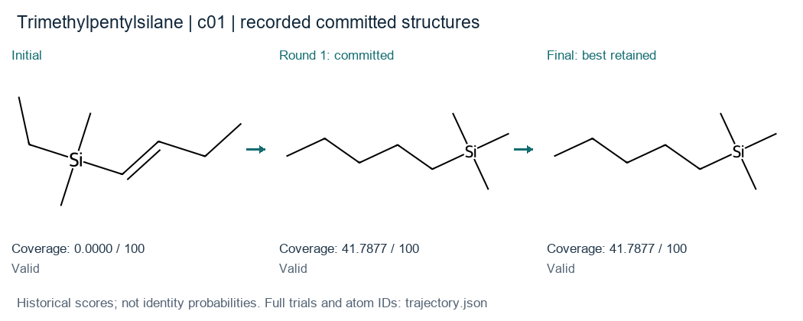

# Trimethylpentylsilane: Silicon-containing structure edits and tied rankings

**English** | [简体中文](README.zh-CN.md)

Focus candidate c01 commits the silicon-containing reference structure in its first round. Six distinct saved structures have the same score. The reference is sixth in display order but tied for first by evidence rank. Display order does not establish independent spectroscopic discrimination; generating the reference does not make it Top1. The run ends when its session allowance is exhausted and remains incomplete under strict end-to-end evaluation.

This is an authorized historical development case, not a random test set or a new experiment with the current version. Model summaries, reasons, and operation explanations below remain in their original language (mostly Chinese), with only Markdown escaping applied. They are model-proposed explanations, not experimentally confirmed mechanisms. No model was rerun, chemical pathway revalidated, or score recalculated.

## Files and reading order

1. [Input](input.json): observed spectrum and ten original candidates. The [reference answer](reference.json) is stored separately for retrospective explanation and evaluation only.
2. This document: candidate sources, the focus trajectory, all trial entries, and the final status.
3. [Full structured trajectory](trajectory.json): initial graphs for every independently computed candidate, committed edit history, tool-call order within sessions, and all trials.
4. [Results and comparisons](result.json): every source slot, original rankings, per-stage evaluations, and costs with known or unknown usage.
5. [Provenance and checksums](provenance.json): historical configuration/source fingerprints, verification of the original frozen inventories, and SHA-256 checksums of public files.

## Input and version

Sample `s01062_ba1377eb3e8d`, 38 spectral peaks, and 10 candidate source slots. Reference structure: `CCCCC[Si](C)(C)C`.
The input uses `raw_linear`. The current loader can validate its format, but historical code and skill versions differ from the current ones; reruns are not guaranteed to produce the same results.
These materials present the saved historical process. They are neither a resumable checkpoint nor a complete verbatim session transcript.

## Ten source slots

| Source | Independently computed candidate | Initial SMILES | Final SMILES | Stop reason |
|---|---|---|---|---|
| c01 | c01 | `CCC=C[Si](C)(C)CC` | `CCCCC[Si](C)(C)C` | case_session_limit |
| c02 | c02 | `CC(C)C=C[Si](C)(C)C` | `CC(C)CC[Si](C)(C)C` | case_session_limit |
| c03 | c03 | `CC=C(CC)[Si](C)(C)C` | `CCC(CC)[Si](C)(C)C` | case_session_limit |
| c04 | c04 | `C=CC(C)C[Si](C)(C)C` | `CC(C)CC[Si](C)(C)C` | case_session_limit |
| c05 | c05 | `C=C(CCC)[Si](C)(C)C` | `CCCC(C)[Si](C)(C)C` | case_session_limit |
| c06 | c06 | `C=C[Si](C)(C)CCCC` | `CC(C)C(C)[Si](C)(C)C` | case_session_limit |
| c07 | c07 | `CC1CC[Si](C)(C)C1C` | `CCCC(C)[Si](C)(C)C` | case_session_limit |
| c08 | c08 | `C=CCC.C[Si](C)(C)C` | `CC(C)(C)C[Si](C)(C)C` | case_session_limit |
| c09 | c09 | `CCC=CC[Si](C)(C)C` | `CCCC(C)[Si](C)(C)C` | case_session_limit |
| c10 | c08 | `C=CCC.C[Si](C)(C)C` | `CC(C)(C)C[Si](C)(C)C` | case_session_limit |

Graphs and history are stored once per independently computed candidate. All ten source slots and their final states are retained.

## Focus structure trajectory

The figure focuses on `c01`. The initial state, each committed edit, and final output come from the original records. All coverage scores displayed in this document and figure are multiplied by 100.

### Round 1

Original model summary (not a confirmed mechanism): 原图 C8H18Si(M=142) 与谱图不符：142 无峰、144 有峰、129=144−15。按 M=144 的 C8H20Si 重排为三甲基正戊基硅烷，工具验证合法并支持 144/129/73(0.418，超历史最佳 0.381)；59、43、45、87 等仍为未解释峰，m/z 144 强度很弱，三甲基烷基硅烷各支链异构体在本规则集下同分不可区分。

Committed: **Yes**; tool/host verdict: `valid_exploration`; coverage score: 41.787709.
Resulting structure: `CCCCC[Si](C)(C)C`.
Original model reason: 谱图无 m/z 142 峰而 m/z 144 有峰(强度2)，且 129 与 144 相差恰为 15；若母体为142则 129 需失去 CH(13)，无对应原子路径。改按 M=144(C8H20Si) 解释：保留 Si(CH3)3 并使 Si 只连饱和碳，9 项编辑把烯基/乙基重排为正戊基三甲基硅烷。工具验证合法(C8H20Si, nominal 144)，给出 molecular_ion 144、tms_methyl_radical_loss 129(Si–CH3 断裂)与 tms_cation_cleavage 73 三条路径，分 0.418 高于历史最佳 0.381；59、43、45、87 等仍无规则解释，三甲基烷基硅烷的异构体只能同分并列，本试验不构成唯一鉴定。

| Operation | Original model explanation |
|---|---|
| `{"op": "set_bond", "a": "Mol_C_3", "b": "Mol_C_4", "order": 1}` | Mol_C_3–Mol_C_4 由双键改单键(C3=C4→C3–C4)，饱和化第一步；129/144 路径所要求的饱和硅烷前提。 |
| `{"op": "set_atom", "id": "Mol_C_3", "hydrogens": 2}` | Mol_C_3 由 CH 改为 CH2，为第 1 项键级修改补 1H。 |
| `{"op": "set_atom", "id": "Mol_C_4", "hydrogens": 2}` | Mol_C_4 由 CH 改为 CH2，与第 1 项键级修改配套补 1H。 |
| `{"op": "remove_bond", "a": "Mol_Si_1", "b": "Mol_C_7"}` | 删除 Mol_Si_1–Mol_C_7 键，将乙基从 Si 上移出以便并入主链。 |
| `{"op": "remove_bond", "a": "Mol_C_7", "b": "Mol_C_8"}` | 删除 Mol_C_7–Mol_C_8 键，拆开原 Si–CH2–CH3 片段。 |
| `{"op": "set_bond", "a": "Mol_Si_1", "b": "Mol_C_8", "order": 1}` | 新建 Mol_Si_1–Mol_C_8 单键，使 C8 成为第三个 Si–CH3，构成 TMS。 |
| `{"op": "set_bond", "a": "Mol_C_7", "b": "Mol_C_1", "order": 1}` | 新建 Mol_C_7–Mol_C_1 单键，把 C7 接到 C1 上延长为戊基链。 |
| `{"op": "set_atom", "id": "Mol_C_7", "hydrogens": 3}` | Mol_C_7 由 CH2 改为 CH3(此时仅连 C1)。 |
| `{"op": "set_atom", "id": "Mol_C_1", "hydrogens": 2}` | Mol_C_1 由 CH3 改为 CH2(新增 C1–C7 后为 2 键)。 |

### Round 2

Original model summary (not a confirmed mechanism): 保留 n-戊基三甲基硅烷（CCCCC&#91;Si&#93;(C)(C)C，C8H20Si，名义质量144）：当前图 gv1 的原子/邻接已核对（C7–C1–C2–C3–C4–Si，Si 另接三个 CH3，全部碳为4价），工具验证合法。谱图被 73（基峰, 999）、59（467）、43（155）、45（145）、129（121）、144（2）主导；规则给出 e1 分子离子 144、e2/e3/e4 三条 Si–CH3 自由基丢失到 129、e5 Si–C 断裂生成 C3H9Si+ 73，覆盖 0.418 的强度。未解释的强峰 59（w=0.174）、43、45、74、75 属硅基/烷基离子（如 C2H7Si+、SiCH5+ 类）及烷基链碎片，当前硅规则未实现此类通道，不能加分也不作为否定证据。case_exploration 中8种戊基位置异构体（含直链、1-/2-/3-甲基丁基、1-乙基丙基、叔戊基、新戊基）以及乙基/丁基/二甲基、二丙基等分配均与本结构同为 0.418 或更低分，163 无任何异构体区分证据；剩余可解释空间受规则覆盖限制，未见可提升的未提交方案，故保留。结论局限：73/129/144 只支持 TMS 型骨架，不能区分同质量（C8H20Si）异构体；m/z 59、43、45 的归属仅为待验证假说。

## All tool trials

Entries follow receipt-file order and the order within each receipt; this does not establish an exact chronology across concurrent sessions. A selected tool reference is not necessarily a host commit. Committed state changes are identified by `committed` in candidate `rounds`.

| Session | Candidate / graph version | Trial ID | Valid | Tool verdict | Reference selected | Coverage score |
|---|---|---|---|---|---|---|
| 1 | c01 / 0 | `t_21abc9d343639cdeed13d9ae` | True | valid_exploration | True | 41.787709 |
| 1 | c02 / 0 | `t_26b6bd29ef40f842b15d1ec2` | True | valid_exploration | True | 41.787709 |
| 1 | c02 / 0 | `t_00946c65d11a66cc4032383e` | True | valid_exploration | True | 41.787709 |
| 2 | c04 / 0 | `t_96da600d17ffb141493a73f9` | True | valid_exploration | True | 41.787709 |
| 2 | c04 / 0 | `t_bd009db37c4a87955056ba81` | True | valid_exploration | True | 41.787709 |
| 2 | c03 / 0 | `t_a331840a0120ee0fc3664875` | True | valid_exploration | True | 41.787709 |
| 2 | c03 / 0 | `t_57ba08107987a12927deaa28` | True | valid_exploration | True | 41.787709 |
| 3 | c05 / 0 | `t_c662d646b04fe000c4db67f2` | True | valid_exploration | True | 41.787709 |
| 3 | c06 / 0 | `t_8c9e111e0d1fe9d04319fd7c` | True | valid_exploration | False | 0.074488 |
| 3 | c06 / 0 | `t_8ccb5bbf43ecebf46b976ac6` | True | valid_exploration | True | 41.787709 |
| 4 | c08 / 0 | `t_0d3bb3f397cebe7be806ddb2` | True | first_valid_repair | True | 41.787709 |
| 4 | c08 / 0 | `t_4595ca04ab291423f6f694c2` | True | first_valid_repair | True | 41.787709 |
| 4 | c07 / 0 | `t_8ca3cad43f1b0d4ea98cf014` | False | chemical_validation_failed | False | Not scored |
| 4 | c07 / 0 | `t_231709c02945be743c8ec4c4` | True | valid_exploration | True | 41.787709 |
| 5 | c09 / 0 | `t_a80e8c603dc92a9e4e4d08ff` | True | valid_exploration | True | 41.787709 |
| 5 | c09 / 0 | `t_3d8ef779121cf6a8215d9538` | True | valid_exploration | True | 41.787709 |

## Results by stage

| Stage | Complete | Saved ranking Acc@1 / Acc@10 | Strict end-to-end Acc@1 / Acc@10 | Known / estimated cost (CNY) |
|---|---|---|---|---|
| baseline | True | 0.0 / 0.0 | 0.0 / 0.0 | 0.00000000 / 0.00000000 |
| agent | False | 0.0 / 1.0 | 0.0 / 0.0 | 0.64556584 / 0.00000000 |

### Final saved order of unique structures

| Display position | Evidence rank | SMILES | Coverage score | Reference structure |
|---|---|---|---|---|
| 1 | 1 | `CCCC(C)[Si](C)(C)C` | 41.787709 | No |
| 2 | 1 | `CC(C)(C)C[Si](C)(C)C` | 41.787709 | No |
| 3 | 1 | `CC(C)CC[Si](C)(C)C` | 41.787709 | No |
| 4 | 1 | `CC(C)C(C)[Si](C)(C)C` | 41.787709 | No |
| 5 | 1 | `CCC(CC)[Si](C)(C)C` | 41.787709 | No |
| 6 | 1 | `CCCCC[Si](C)(C)C` | 41.787709 | Yes |

## How to interpret these materials

All main Agent runs are provisional/incomplete. Generating the reference structure, selecting Top1, and completing the entire review are distinct outcomes. Strict end-to-end evaluation counts incomplete cases as misses; individual development cases do not establish overall identification accuracy or cost.
The trajectory uses content-addressed object pools (`graphs`, `scores`, and `paths`), deduplicated by SHA-256. Resolve `graph_ref`, `score_ref`, and `path_refs` within the same `trajectory.json`. Atom IDs and graph versions are preserved; atom correspondence is not reconstructed from canonical SMILES.
Input and labels retain the semantics of their source files. Public trajectories are derived materials with selected fields and deduplicated objects. `provenance.json` records public-file hashes separately. The original frozen inventories show that local source files passed verification at export time; public files are not byte-for-byte copies of the complete original results.
Only recorded tool-call metadata, trials, and submitted explanations are included. Hidden reasoning text, raw session streams, credentials, personal paths, and CLI caches are excluded. Unrecorded reasoning cannot be reconstructed from these summaries.
The bundle contains recorded fingerprints, not the complete historical source code. It does not provide all conditions needed to reproduce historical model experiments byte for byte.

Return to the [case-study index](../README.md).
