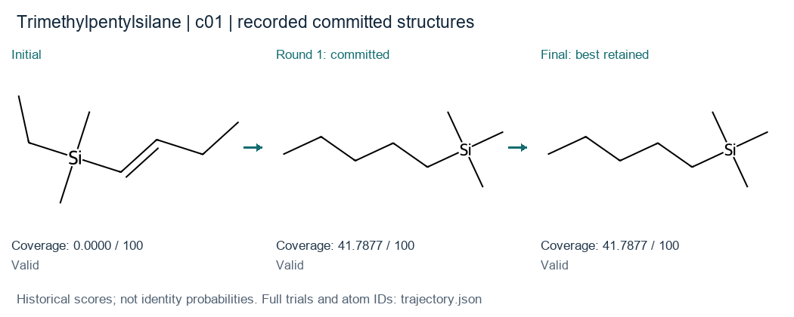

# 三甲基正戊基硅烷：含硅结构编辑与并列排名

[English](README.md) | **简体中文**

关键候选 c01 在第一轮正式提交参考含硅结构。保存结果中六个不同结构同分，参考结构位于展示顺序第 6，证据排名仍为并列第 1。当前展示顺序不等于独立谱学区分；生成参考结构并未让它成为 Top1。整体在会话额度耗尽后结束，严格端到端口径仍记未完成。

这是获准公开的历史开发案例，不是随机测试集或当前版本的新实验。模型文字按原记录保留，为模型提出的解释，不代表实验确认的机理。未重新运行模型、验证化学路径或重算分数。

## 文件与阅读顺序

1. [输入](input.json)：观测谱与十个原始候选；[参考答案](reference.json)独立保存，仅用于事后说明与评估。
2. 本文：候选来源、关键轨迹、全部试验索引及最终状态。
3. [完整结构化轨迹](trajectory.json)：所有独立候选的初始图、正式提交历史、会话工具顺序和全部试验。
4. [结果与对照](result.json)：全部来源槽位、原始排名、各阶段评估及已知/未知费用。
5. [来源与校验](provenance.json)：历史配置/源码指纹、原冻结清单验证与公开文件 SHA-256。

## 输入与版本

样本 `s01062_ba1377eb3e8d`，38 个谱峰，10 个候选来源槽位。参考结构：`CCCCC[Si](C)(C)C`。
输入为 `raw_linear`；当前加载器可校验其格式，但历史代码/技能版本与当前不同，重跑结果不保证一致。
本材料展示已保存的历史过程，不是可恢复检查点或完整会话逐字记录。

## 十个来源槽位

| 来源 | 独立计算候选 | 初始 SMILES | 最终 SMILES | 结束原因 |
|---|---|---|---|---|
| c01 | c01 | `CCC=C[Si](C)(C)CC` | `CCCCC[Si](C)(C)C` | case_session_limit |
| c02 | c02 | `CC(C)C=C[Si](C)(C)C` | `CC(C)CC[Si](C)(C)C` | case_session_limit |
| c03 | c03 | `CC=C(CC)[Si](C)(C)C` | `CCC(CC)[Si](C)(C)C` | case_session_limit |
| c04 | c04 | `C=CC(C)C[Si](C)(C)C` | `CC(C)CC[Si](C)(C)C` | case_session_limit |
| c05 | c05 | `C=C(CCC)[Si](C)(C)C` | `CCCC(C)[Si](C)(C)C` | case_session_limit |
| c06 | c06 | `C=C[Si](C)(C)CCCC` | `CC(C)C(C)[Si](C)(C)C` | case_session_limit |
| c07 | c07 | `CC1CC[Si](C)(C)C1C` | `CCCC(C)[Si](C)(C)C` | case_session_limit |
| c08 | c08 | `C=CCC.C[Si](C)(C)C` | `CC(C)(C)C[Si](C)(C)C` | case_session_limit |
| c09 | c09 | `CCC=CC[Si](C)(C)C` | `CCCC(C)[Si](C)(C)C` | case_session_limit |
| c10 | c08 | `C=CCC.C[Si](C)(C)C` | `CC(C)(C)C[Si](C)(C)C` | case_session_limit |

同一独立计算候选的图与历史只存一份，十个来源槽位及其最终状态全部保留。

## 关键结构轨迹

图中只突出 `c01`；初始状态、每次正式提交与最终输出均来自原记录。图上数值是覆盖分 × 100。

### 第 1 轮

模型提交摘要（未经机理确证）：原图 C8H18Si(M=142) 与谱图不符：142 无峰、144 有峰、129=144−15。按 M=144 的 C8H20Si 重排为三甲基正戊基硅烷，工具验证合法并支持 144/129/73(0.418，超历史最佳 0.381)；59、43、45、87 等仍为未解释峰，m/z 144 强度很弱，三甲基烷基硅烷各支链异构体在本规则集下同分不可区分。

正式提交：**是**；工具/宿主结论：`valid_exploration`；覆盖分：41.787709。
结果结构：`CCCCC[Si](C)(C)C`。
模型理由：谱图无 m/z 142 峰而 m/z 144 有峰(强度2)，且 129 与 144 相差恰为 15；若母体为142则 129 需失去 CH(13)，无对应原子路径。改按 M=144(C8H20Si) 解释：保留 Si(CH3)3 并使 Si 只连饱和碳，9 项编辑把烯基/乙基重排为正戊基三甲基硅烷。工具验证合法(C8H20Si, nominal 144)，给出 molecular_ion 144、tms_methyl_radical_loss 129(Si–CH3 断裂)与 tms_cation_cleavage 73 三条路径，分 0.418 高于历史最佳 0.381；59、43、45、87 等仍无规则解释，三甲基烷基硅烷的异构体只能同分并列，本试验不构成唯一鉴定。。

| 操作 | 模型逐项说明 |
|---|---|
| `{"op": "set_bond", "a": "Mol_C_3", "b": "Mol_C_4", "order": 1}` | Mol_C_3–Mol_C_4 由双键改单键(C3=C4→C3–C4)，饱和化第一步；129/144 路径所要求的饱和硅烷前提。 |
| `{"op": "set_atom", "id": "Mol_C_3", "hydrogens": 2}` | Mol_C_3 由 CH 改为 CH2，为第 1 项键级修改补 1H。 |
| `{"op": "set_atom", "id": "Mol_C_4", "hydrogens": 2}` | Mol_C_4 由 CH 改为 CH2，与第 1 项键级修改配套补 1H。 |
| `{"op": "remove_bond", "a": "Mol_Si_1", "b": "Mol_C_7"}` | 删除 Mol_Si_1–Mol_C_7 键，将乙基从 Si 上移出以便并入主链。 |
| `{"op": "remove_bond", "a": "Mol_C_7", "b": "Mol_C_8"}` | 删除 Mol_C_7–Mol_C_8 键，拆开原 Si–CH2–CH3 片段。 |
| `{"op": "set_bond", "a": "Mol_Si_1", "b": "Mol_C_8", "order": 1}` | 新建 Mol_Si_1–Mol_C_8 单键，使 C8 成为第三个 Si–CH3，构成 TMS。 |
| `{"op": "set_bond", "a": "Mol_C_7", "b": "Mol_C_1", "order": 1}` | 新建 Mol_C_7–Mol_C_1 单键，把 C7 接到 C1 上延长为戊基链。 |
| `{"op": "set_atom", "id": "Mol_C_7", "hydrogens": 3}` | Mol_C_7 由 CH2 改为 CH3(此时仅连 C1)。 |
| `{"op": "set_atom", "id": "Mol_C_1", "hydrogens": 2}` | Mol_C_1 由 CH3 改为 CH2(新增 C1–C7 后为 2 键)。 |

### 第 2 轮

模型提交摘要（未经机理确证）：保留 n-戊基三甲基硅烷（CCCCC&#91;Si&#93;(C)(C)C，C8H20Si，名义质量144）：当前图 gv1 的原子/邻接已核对（C7–C1–C2–C3–C4–Si，Si 另接三个 CH3，全部碳为4价），工具验证合法。谱图被 73（基峰, 999）、59（467）、43（155）、45（145）、129（121）、144（2）主导；规则给出 e1 分子离子 144、e2/e3/e4 三条 Si–CH3 自由基丢失到 129、e5 Si–C 断裂生成 C3H9Si+ 73，覆盖 0.418 的强度。未解释的强峰 59（w=0.174）、43、45、74、75 属硅基/烷基离子（如 C2H7Si+、SiCH5+ 类）及烷基链碎片，当前硅规则未实现此类通道，不能加分也不作为否定证据。case_exploration 中8种戊基位置异构体（含直链、1-/2-/3-甲基丁基、1-乙基丙基、叔戊基、新戊基）以及乙基/丁基/二甲基、二丙基等分配均与本结构同为 0.418 或更低分，163 无任何异构体区分证据；剩余可解释空间受规则覆盖限制，未见可提升的未提交方案，故保留。结论局限：73/129/144 只支持 TMS 型骨架，不能区分同质量（C8H20Si）异构体；m/z 59、43、45 的归属仅为待验证假说。

## 全部工具试验

按回执文件顺序、回执内记录顺序列出；并发会话之间不据此推断精确时间顺序。工具选中引用不等于宿主最终提交，正式提交以候选 rounds 中的 committed 为准。

| 会话 | 候选 / 图版本 | 试验 ID | 合法 | 工具结论 | 引用选中 | 覆盖分 |
|---|---|---|---|---|---|---|
| 1 | c01 / 0 | `t_21abc9d343639cdeed13d9ae` | True | valid_exploration | True | 41.787709 |
| 1 | c02 / 0 | `t_26b6bd29ef40f842b15d1ec2` | True | valid_exploration | True | 41.787709 |
| 1 | c02 / 0 | `t_00946c65d11a66cc4032383e` | True | valid_exploration | True | 41.787709 |
| 2 | c04 / 0 | `t_96da600d17ffb141493a73f9` | True | valid_exploration | True | 41.787709 |
| 2 | c04 / 0 | `t_bd009db37c4a87955056ba81` | True | valid_exploration | True | 41.787709 |
| 2 | c03 / 0 | `t_a331840a0120ee0fc3664875` | True | valid_exploration | True | 41.787709 |
| 2 | c03 / 0 | `t_57ba08107987a12927deaa28` | True | valid_exploration | True | 41.787709 |
| 3 | c05 / 0 | `t_c662d646b04fe000c4db67f2` | True | valid_exploration | True | 41.787709 |
| 3 | c06 / 0 | `t_8c9e111e0d1fe9d04319fd7c` | True | valid_exploration | False | 0.074488 |
| 3 | c06 / 0 | `t_8ccb5bbf43ecebf46b976ac6` | True | valid_exploration | True | 41.787709 |
| 4 | c08 / 0 | `t_0d3bb3f397cebe7be806ddb2` | True | first_valid_repair | True | 41.787709 |
| 4 | c08 / 0 | `t_4595ca04ab291423f6f694c2` | True | first_valid_repair | True | 41.787709 |
| 4 | c07 / 0 | `t_8ca3cad43f1b0d4ea98cf014` | False | chemical_validation_failed | False | 未评分 |
| 4 | c07 / 0 | `t_231709c02945be743c8ec4c4` | True | valid_exploration | True | 41.787709 |
| 5 | c09 / 0 | `t_a80e8c603dc92a9e4e4d08ff` | True | valid_exploration | True | 41.787709 |
| 5 | c09 / 0 | `t_3d8ef779121cf6a8215d9538` | True | valid_exploration | True | 41.787709 |

## 各阶段结果

| 阶段 | 完成 | 保存排名 Acc@1 / Acc@10 | 严格端到端 Acc@1 / Acc@10 | 已知费用 / 估算费用（元） |
|---|---|---|---|---|
| baseline | True | 0.0 / 0.0 | 0.0 / 0.0 | 0.00000000 / 0.00000000 |
| agent | False | 0.0 / 1.0 | 0.0 / 0.0 | 0.64556584 / 0.00000000 |

### 最终保存的唯一结构顺序

| 展示位置 | 证据排名 | SMILES | 覆盖分 | 参考结构 |
|---|---|---|---|---|
| 1 | 1 | `CCCC(C)[Si](C)(C)C` | 41.787709 | 否 |
| 2 | 1 | `CC(C)(C)C[Si](C)(C)C` | 41.787709 | 否 |
| 3 | 1 | `CC(C)CC[Si](C)(C)C` | 41.787709 | 否 |
| 4 | 1 | `CC(C)C(C)[Si](C)(C)C` | 41.787709 | 否 |
| 5 | 1 | `CCC(CC)[Si](C)(C)C` | 41.787709 | 否 |
| 6 | 1 | `CCCCC[Si](C)(C)C` | 41.787709 | 是 |

## 如何理解这些材料

全部主要 Agent 运行均为 provisional/incomplete。生成参考结构、选择 Top1 和完成整个审阅是三个不同结果。严格端到端口径把未完成案例记为未命中；单个开发案例不能证明总体识别率或费用。
轨迹中的 graphs、scores、paths 为按内容 SHA-256 去重的对象池；graph_ref、score_ref、path_refs 在同一 trajectory.json 内解析。原子 ID 和图版本保留，不用 canonical SMILES 重建原子对应关系。
原始输入和标签与源文件语义一致。公开轨迹是字段筛选和对象去重后的派生材料，provenance.json 单独记录公开文件哈希；原冻结清单仅说明导出时本地原文件核验通过，不表示公开文件与原始整份结果逐字节相同。
只包含已记录的工具调用元数据、试验与正式说明，不包含隐藏思考正文、原始会话流、凭据、个人路径或 CLI 缓存。无法从这些摘要补出未记录的推理过程。
完整历史源码不在本包中，只有原记录指纹，不能声称具备逐字节重现旧模型实验的全部条件。

返回[案例导航](../README.zh-CN.md)。
