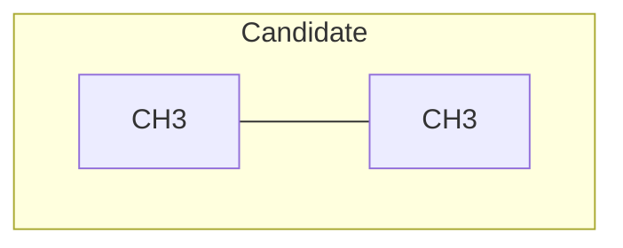
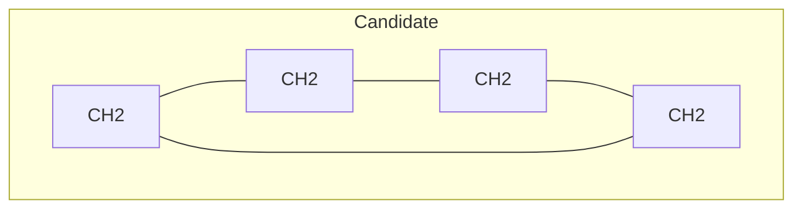
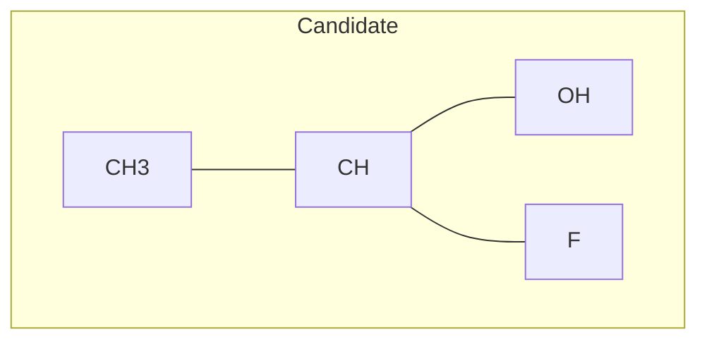

# 异常图与拓扑编辑边界

下列 JSON 展示旧单候选 `validate_proposal` / `analyze_proposal` 的试验参数，示例图版本为 0；真实任务必须使用当前 `graph_version`。旧接口通过 `submit_review` 正式提交，并补充该接口要求的解释字段。
默认批审中，为示例的 `base_version`、`operations` 补充当前 `candidate_id`，放入 `analyze_proposals` 的 `proposals` 数组。正式提交通过 `submit_reviews` 的 `reviews` 数组覆盖本批全部候选；各候选的 `proposals` 只引用当前会话的 `trial_id` 并提供 `reason`、`peak_refs`、`operation_explanations`，不再重复操作。完整协议见 `constrained-structure-edit/references/batch-review.md`。
所有操作整体应用于副本，试验不自动提交结构；不能把本示例当作对任意谱图的改造指令。

这些是独立合成的教学结构，没有实验谱峰，不能作为编辑的质谱证据。图中为节约阅读量省略了默认零值元数据，非零同位素/构型/芳香标记均保留；这不授权删除实际工具输入中的元数据。原子 ID 仅对当前图稳定，不应跨案例按编号对应。

<!-- case:nonring_aromatic -->
## 芳香标记错误：检查标记与实际拓扑



C1 被 %%@atom 标记 aromatic=true，但全图只有一条普通单键、没有任何环；不能把这个标记当成合法芳香性的证明。保留 CH3–CH3 拓扑与氢数，明确把这个错误标记改为 false 后再验证。此例是非环原子的标记错误；真正的芳香环异常还要逐项核对环连接、各键级、原子标记和氢数，不能统一清空芳香性。

预期通过化学验证：

```json
{
  "base_version": 0,
  "operations": [
    {
      "op": "set_atom",
      "id": "Mol_C_1",
      "aromatic": false
    }
  ]
}
```

<!-- case:ring_rewire -->
## 环重连：同一批次改变拓扑与氢数



初始环是 C1–C2–C3–C4–C1。删除 C1–C4 后，C1 与 C4 仍通过 C2、C3 连通，所以断掉一条环键不一定产生两个片段。再增加 C1–C3 后形成三元环 C1–C2–C3–C1，C4 成为 C3 上的甲基。C3 从 CH2 变 CH，C4 从 CH2 变 CH3；C1 的连接数先减后增，最终仍是 CH2。四项操作整体校验，重原子和 C4H8 分子式均保持；这种教学结构重排不自带谱图支持。

预期通过化学验证：

```json
{
  "base_version": 0,
  "operations": [
    {
      "op": "remove_bond",
      "a": "Mol_C_1",
      "b": "Mol_C_4"
    },
    {
      "op": "set_bond",
      "a": "Mol_C_1",
      "b": "Mol_C_3",
      "order": 1
    },
    {
      "op": "set_atom",
      "id": "Mol_C_3",
      "hydrogens": 1
    },
    {
      "op": "set_atom",
      "id": "Mol_C_4",
      "hydrogens": 3
    }
  ]
}
```

<!-- case:specified_stereo_rejection -->
## 已指定手性中心：识别工具能力边界



C2 的非零 chiral_tag 是相对于邻接顺序的构型记录，不能把整数 2 直接称为 R 或 S。下面试验把 OH 从 C2 移到 C1；虽然也配套改了氢数，却改变了已指定手性中心 C2 的邻接，当前工具必须拒绝。收到这种错误后应保留构型并说明不支持，而不是删除 chiral_tag、改写为 _R/_S 或不断重试同一方案。

预期被拒绝（反例）：

```json
{
  "base_version": 0,
  "operations": [
    {
      "op": "remove_bond",
      "a": "Mol_C_2",
      "b": "Mol_O_1"
    },
    {
      "op": "set_bond",
      "a": "Mol_C_1",
      "b": "Mol_O_1",
      "order": 1
    },
    {
      "op": "set_atom",
      "id": "Mol_C_1",
      "hydrogens": 2
    },
    {
      "op": "set_atom",
      "id": "Mol_C_2",
      "hydrogens": 2
    }
  ]
}
```
