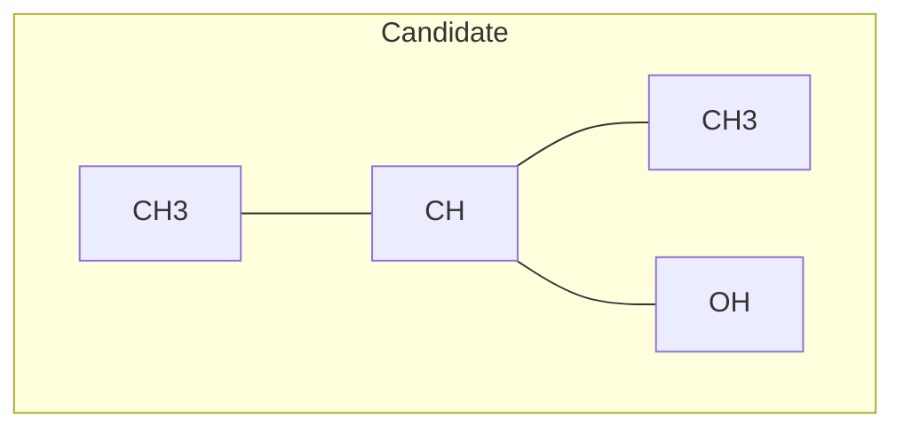
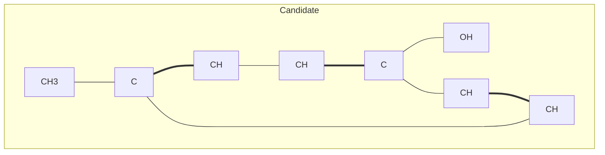
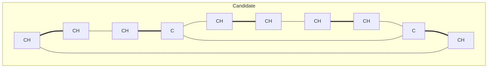
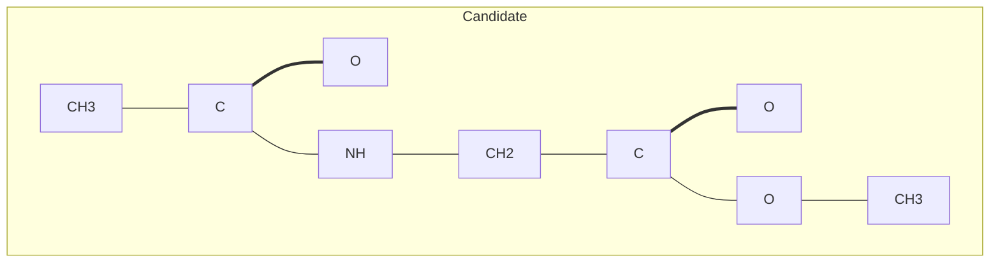
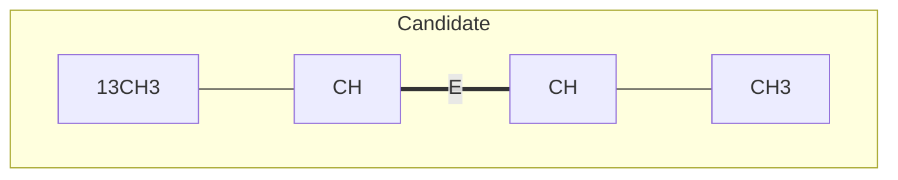

# 读图示例：支链、环和官能团

按需要查看相应结构，先看节点与边，再核对后面的解读。

这些是独立合成的教学结构，没有实验谱峰，不能作为编辑的质谱证据。图中为节约阅读量省略了默认零值元数据，非零同位素/构型/芳香标记均保留；这不授权删除实际工具输入中的元数据。原子 ID 仅对当前图稳定，不应跨案例按编号对应。

<!-- case:branched_alcohol -->
## 邻接分叉：不要把氧接在链尾

先找连接三条重原子边的 Mol_C_2：邻居是 Mol_C_1、Mol_C_3、Mol_O_1，三条均为单键。Mol_C_2 的标签是 CH，另两个碳是 CH3；这是羟基接在中间碳上的仲醇。三碳骨架 C1–C2–C3 本身是直链，包含氧的重原子图在 C2 处分叉；不能把 C1–C2–C3–O1 当作链。共 3 个碳，分子式 C3H8O。

<!-- case:substituted_aromatic -->
## 芳香取代：从闭合路径找取代位点

闭合路径是 C2–C3–C4–C5–C6–C7–C2（这里的 Cn 均指 Mol_C_n）。C1 是接在 C2 上的环外甲基，O1 接在 C5 上且带一个氢，是酚羟基。两个取代位置沿环相隔三条边；C2、C5 均为 [C]，不能再补一个氢。正常输入在本适配器中显示为 Kekulé 单双键；交替单双键本身不能代替芳香性验证。

<!-- case:fused_rings -->
## 稠环：共享原子只数一次

两个六元闭合路径为 C1–C2–C3–C4–C9–C10–C1 与 C4–C5–C6–C7–C8–C9–C4。它们共用 C4、C9 和 C4–C9 这条边；重原子总数是 6+6−2=10，不是 12。共享的 C4、C9 各连三个碳且没有氢。这里列的是可核对的两个环路径；不能由任意图的所有闭合路径数量直接定义化学环数。

<!-- case:carbonyl_context -->
## 官能团：羰基相邻原子决定名称

C2===O1 且 C2---N1，构成酰胺局部结构；N1 不是可脱离羰基环境单独解释的普通胺。C4===O2 且 C4---O3---C5，构成酯。O3 没有氢，是连接两个碳的酯氧，不是醇羟基。两个羰基氧均为 [O]，不能把零氢误解为未知氢。

<!-- case:isotope_ez -->
## 同位素与 E/Z：保留身份和参考原子

[13CH3] 是一个 13C 原子带三个氢，不是 13 个碳。C2===|E|C3 的 E 标记与 %%@bond 中的 stereo=3 及按两端对应排列的参考原子 [C1,C4] 一起保存。不得删去元数据后仅凭裸 E 标记重建结构；也不能把这两个参考原子重新编号。该例只是读取/保留已有构型，MCP 编辑接口没有重新设置 stereo/stereo_atoms 的字段。
