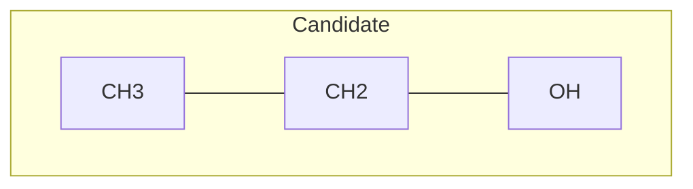
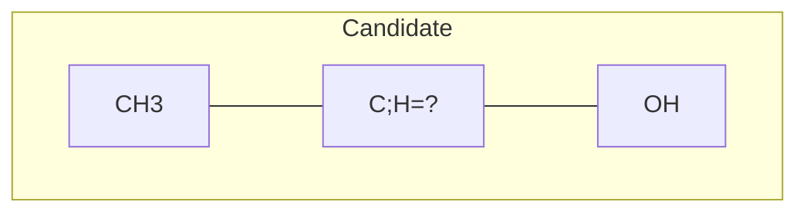
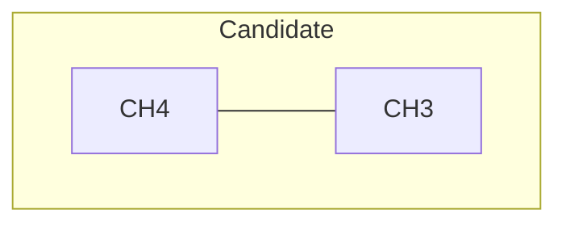

# 事务编辑：键级、未知氢与价态

下列 JSON 展示旧单候选 `validate_proposal` / `analyze_proposal` 的试验参数；真实调用时将 `base_version` 换成当前 `graph_version`。旧接口通过 `submit_review` 正式提交，并补充该接口要求的解释字段。
默认批审中，将示例的 `base_version`、`operations` 与当前 `candidate_id` 组成提案，放入 `analyze_proposals` 的 `proposals` 数组。取得当前会话的 `trial_id` 后，通过 `submit_reviews` 的 `reviews` 数组覆盖本批全部候选；各候选的 `proposals` 引用试验 ID，并提供 `reason`、`peak_refs`、`operation_explanations`，不再重复操作。完整协议见 `constrained-structure-edit/references/batch-review.md`。
试验通过不自动提交结构。宿主验证化学修复或合法探索，并单独保留历史最佳结果；允许同分或降分探索，不要求每次接受都提高分数。

这些是独立合成的教学结构，没有实验谱峰，不能作为编辑的质谱证据。图中为节约阅读量省略了默认零值元数据，非零同位素/构型/芳香标记均保留；这不授权删除实际工具输入中的元数据。原子 ID 仅对当前图稳定，不应跨案例按编号对应。

<!-- case:alcohol_to_aldehyde -->
## 键级和氢数要作为一个事务修改



若另外已有证据支持醛假说，C2–O1 从单键改双键时，C2 的 CH2 要变 CH，O1 的 OH 要变 O。第一段 JSON 是可通过化学验证的完整试验；第二段只改键级，会因保留过多氢被拒绝。重原子保持 C2O，但分子式从 C2H6O 变 C2H4O，必须重算谱图证据。合法性通过不代表宿主会接受这次合法→合法优化。

预期通过化学验证：

```json
{
  "base_version": 0,
  "operations": [
    {
      "op": "set_bond",
      "a": "Mol_C_2",
      "b": "Mol_O_1",
      "order": 2
    },
    {
      "op": "set_atom",
      "id": "Mol_C_2",
      "hydrogens": 1
    },
    {
      "op": "set_atom",
      "id": "Mol_O_1",
      "hydrogens": 0
    }
  ]
}
```

预期被拒绝（反例）：

```json
{
  "base_version": 0,
  "operations": [
    {
      "op": "set_bond",
      "a": "Mol_C_2",
      "b": "Mol_O_1",
      "order": 2
    }
  ]
}
```

<!-- case:unknown_hydrogen -->
## 未知氢不是零氢



[C;H=?] 表示氢数尚未确定，`graph.atoms` 中该原子的 `hydrogens` 为 null；它不同于 [C]（已知零氢）。此例 C2 只连 C1 和 O1 两条单键，且已知其为中性、无自由基碳；因此提出 hydrogens=2 的候选修复，再由工具验收。不要把这个补氢结论套到芳香碳、带电原子或自由基上。

预期通过化学验证：

```json
{
  "base_version": 0,
  "operations": [
    {
      "op": "set_atom",
      "id": "Mol_C_2",
      "hydrogens": 2
    }
  ]
}
```

<!-- case:overvalent_carbon -->
## 过价碳：保留连接，修正明确的氢状态



C1 的 [CH4] 再连 C2 一条单键，相当于五个普通共价键价，输入图可读但不合法。此教学修复把 C1 的氢数改为 3，保留两个碳及其连接，产物为 C2H6。这里只展示一种化学修复；没有观测谱峰，不声称它是实验正确结构。

预期通过化学验证：

```json
{
  "base_version": 0,
  "operations": [
    {
      "op": "set_atom",
      "id": "Mol_C_1",
      "hydrogens": 3
    }
  ]
}
```
